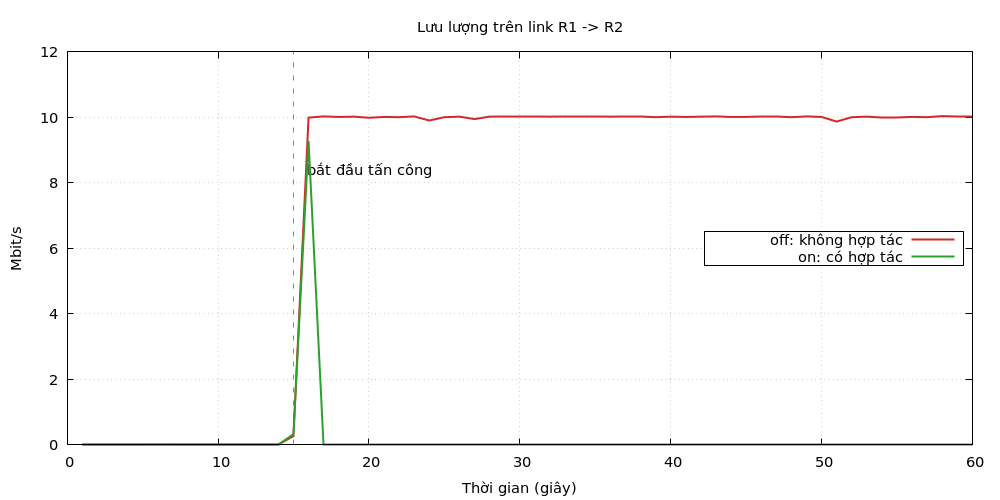

# Cải thiện hiệu năng mạng nhờ các node cộng tác chặn truy vấn xấu

Đồ án môn học: demo bằng C trên Linux, chạy trong EVE-NG.

Một máy tấn công gửi dồn dập truy vấn rác (UDP flood) tới server. Router R3 đứng cạnh server phát hiện kẻ tấn công.

- **Không hợp tác:** R3 tự chặn. Server được bảo vệ, nhưng rác vẫn chạy đầy đường R1 → R2 → R3, người dùng thật vẫn bị chậm.
- **Có hợp tác:** R3 gửi cảnh báo cho R1 và R2. R1 chặn ngay ở cửa vào, mạng thông thoáng lại trong khoảng 1 giây.

Các khái niệm mạng cần biết để trình bày nằm trong [CONCEPTS.md](CONCEPTS.md).

---

## 1. Kết quả đo trên EVE-NG

Trung bình sau khi bị tấn công (giây 16 tới 60), lấy từ `scripts/plot.sh results/eve`:

| Lượt | RTT của client | Mất gói | Lưu lượng link R1 → R2 |
|---|---|---|---|
| **off**: không hợp tác | **410 ms** | 0% | **10 Mbit/s** (đầy, toàn rác) |
| **on**: có hợp tác | **8 ms** (sau 1 giây về ~2 ms) | 0% | **0,2 Mbit/s** |

- R3 phát hiện kẻ tấn công **0,7 giây** sau khi bắt đầu tấn công.
- R1 chặn **2 ms** sau khi R3 phát hiện, nhờ cảnh báo đi trên mạng điều khiển riêng.
- Lúc bình thường RTT khoảng 2 ms.
- Client không mất gói vì hàng đợi ở nút cổ chai giới hạn theo byte: gói rác 1000 byte bị vứt, còn gói truy vấn nhỏ vẫn chen vào được nhưng phải chờ khoảng 400 ms.




---

## 2. Mô hình mạng

```
 Attacker 10.0.1.10 ─┐
                     ├─ R1 ══10Mbit══ R2 ══10Mbit══ R3 ── Server 10.0.3.10
 Client   10.0.1.20 ─┘   │             │              │
                         └──── mạng điều khiển 10.0.99.0/24 ────┘
```

| Mạng | Địa chỉ | Dùng để |
|---|---|---|
| LAN1 | 10.0.1.0/24 | Attacker, Client, R1 (.1) |
| R1–R2 | 10.0.12.0/24 | dữ liệu, giới hạn 10 Mbit/s |
| R2–R3 | 10.0.23.0/24 | dữ liệu, giới hạn 10 Mbit/s |
| R3–Server | 10.0.3.0/24 | Server (.10), R3 (.1) |
| CTRL | 10.0.99.0/24 | cảnh báo giữa R1 (.1), R2 (.2), R3 (.3) |
| MGMT | 172.30.0.0/24 | quản lý: máy EVE (.1) SSH vào node 1..6 (.11 tới .16) |

Trong mỗi node: `eth0` là MGMT, `eth1` trở đi là mạng dữ liệu. Chi tiết nằm trong `lab/<node>.sh`.

---

## 3. Cấu trúc thư mục

| Đường dẫn | Nội dung |
|---|---|
| `src/` | 4 chương trình C (`server`, `client`, `attacker`, `guard`) và các module dùng chung |
| `tests/` | unit test, chạy bằng `make test` |
| `lab/<node>.sh` | cấu hình IP, route, `tc` cho từng node |
| `lab/nodes.conf` | IP quản lý của 6 node EVE |
| `lab/eve-make-image.sh` | tạo image Alpine cho node EVE (chạy một lần) |
| `lab/eve-create-lab.sh` | tạo lab 6 node trong EVE qua API (chạy một lần) |
| `lab/netns-up.sh`, `lab/netns-down.sh` | mini-lab dự phòng bằng network namespace |
| `scripts/lab-up.sh` | chuẩn bị lab trước giờ demo, in `SẴN SÀNG` khi mọi thứ ổn |
| `scripts/tmux-demo.sh off\|on` | màn hình demo 4 ô |
| `scripts/demo.sh off\|on` | chạy một lượt 60 giây, ghi kết quả vào `results/` |
| `scripts/plot.sh` | vẽ biểu đồ và in bảng tóm tắt |
| `scripts/reset.sh` | dừng mọi tiến trình demo, xóa rule chặn |
| `results/eve/` | kết quả một lần chạy tốt trên EVE |

---

## 4. Cài đặt (làm một lần)

Mọi script đều chạy **bên trong máy ảo EVE-NG**. Máy ảo EVE bản chất là Ubuntu 22.04. Máy thật chỉ cần phần mềm chạy máy ảo, trình duyệt và lệnh `ssh`, nên cài trên Ubuntu hay Windows đều được.

Cấu hình tối thiểu: RAM 16GB, ổ cứng trống 70GB, CPU bật ảo hóa (Intel VT-x hoặc AMD-V).

### 4.1. Cài máy ảo EVE-NG

**Trên Ubuntu (KVM):**

```
sudo apt-get update
sudo apt-get install -y qemu-kvm libvirt-daemon-system libvirt-clients virtinst virt-manager
sudo usermod -aG libvirt,kvm $USER     # rồi đăng xuất, đăng nhập lại
```

Tải `eve-ce-prod-6.2.0-4-full.iso` từ eve-ng.net (Download → Community) vào `~/Downloads/`, rồi tạo máy ảo:

```
virt-install --connect qemu:///system --name eve-ng --memory 6144 --vcpus 4 \
  --cpu host-passthrough --disk size=60,format=qcow2 \
  --cdrom ~/Downloads/eve-ce-prod-6.2.0-4-full.iso \
  --network network=default --os-variant ubuntu22.04 --graphics spice --noautoconsole
virt-manager    # mở màn hình máy ảo eve-ng để cài
```

**Trên Windows (VMware Workstation Pro, miễn phí):**

1. Tắt Hyper-V để VMware chạy được máy ảo lồng nhau:
   - Vào "Turn Windows features on or off", bỏ tick Hyper-V, Virtual Machine Platform, Windows Hypervisor Platform, Windows Sandbox, Windows Subsystem for Linux.
   - Vào Windows Security → Device security → Core isolation, tắt Memory integrity.
   - Mở cmd bằng quyền Administrator, chạy `bcdedit /set hypervisorlaunchtype off`.
   - Khởi động lại máy.
2. Cài VMware Workstation Pro (tải ở support.broadcom.com, cần tài khoản Broadcom).
3. New Virtual Machine → chọn file ISO EVE-NG, Guest OS là Linux / Ubuntu 64-bit. Cấu hình RAM 6GB, 4 CPU, ổ 60GB, mạng NAT. Ở mục Processors, tick **Virtualize Intel VT-x/EPT or AMD-V/RVI**.

**Cài EVE trong máy ảo (giống nhau cho cả hai):**

1. Ở menu khởi động, chọn **Install EVE VM**, để mặc định hết.
2. Sau khi máy khởi động lại, đăng nhập `root` / `eve`. Trình thiết lập lần đầu sẽ hỏi:
   - Đặt mật khẩu root mới.
   - Hostname, domain: để mặc định.
   - IP: chọn **dhcp**.
   - NTP: để trống.
   - Proxy: chọn direct.
3. Màn hình đăng nhập hiện địa chỉ IP của EVE. Bên dưới, IP này viết là `<EVE_IP>`.
4. Giao diện web: `http://<EVE_IP>`, tài khoản `admin` / `eve`.

### 4.2. Đưa dự án vào EVE và dựng lab

Chạy trên máy thật (Ubuntu: terminal, Windows: cmd hoặc PowerShell), trong thư mục cha của `onejack`:

```
ssh-copy-id root@<EVE_IP>            # Windows không có ssh-copy-id, xem ghi chú bên dưới
scp -r onejack root@<EVE_IP>:/root/
ssh root@<EVE_IP>
```

Trên Windows, thay `ssh-copy-id` bằng lệnh sau (tạo khóa trước bằng `ssh-keygen` nếu chưa có):

```
type %USERPROFILE%\.ssh\id_ed25519.pub | ssh root@<EVE_IP> "mkdir -p ~/.ssh && cat >> ~/.ssh/authorized_keys"
```

Sau đó, trong máy EVE:

```
cd /root/onejack
apt-get install -y gnuplot-nox      # để vẽ biểu đồ
make && make test                   # build 4 chương trình C (biên dịch tĩnh)
bash lab/eve-make-image.sh          # tạo image Alpine, khoảng 2 phút
bash lab/eve-create-lab.sh          # tạo lab collab-defense 6 node và bật lên
scripts/lab-up.sh                   # cấu hình node, kiểm tra, phải in SẴN SÀNG
```

---

## 5. Chạy demo

Mỗi lần bật máy:

1. Bật máy ảo EVE:
   - Ubuntu: `virsh -c qemu:///system start eve-ng`
   - Windows: bấm Power on trong VMware.
2. SSH vào EVE và chuẩn bị lab:
   ```
   ssh root@<EVE_IP>
   cd /root/onejack
   scripts/lab-up.sh          # khoảng 40 giây, phải in SẴN SÀNG
   ```
3. Chạy hai lượt trên màn hình demo. Mỗi lượt 60 giây, tấn công bắt đầu ở giây 15.
   ```
   scripts/tmux-demo.sh off   # chạy xong gõ exit
   scripts/tmux-demo.sh on    # chạy xong gõ exit
   ```

   Màn hình chia 4 ô:

   | Vị trí | Hiển thị |
   |---|---|
   | Trên trái | RTT của client |
   | Dưới trái | Lưu lượng link R1 → R2 |
   | Trên phải | Sự kiện phát hiện và cảnh báo |
   | Dưới phải | Tiến trình `demo.sh` |
4. Vẽ biểu đồ và in bảng so sánh:
   ```
   scripts/plot.sh
   ```
   Biểu đồ nằm ở `results/rtt.png`, `results/loss.png`, `results/link.png`. Để lấy về máy thật: `scp root@<EVE_IP>:/root/onejack/results/*.png .`

Muốn đổi thông số (thời gian, tốc độ tấn công, ngưỡng phát hiện), sửa phần đầu `scripts/demo.sh`.

---

## 6. Phương án dự phòng

Nếu lab EVE gặp sự cố lúc demo, có hai cách:

**Mini-lab bằng network namespace.** Dựng cùng mô hình mạng nhưng không cần máy ảo node nào. Chạy được trên máy Ubuntu thật hoặc ngay trong máy ảo EVE, nên Windows cũng dùng được.

```
lab/netns-up.sh                     # trên Ubuntu thật thì thêm sudo trước mỗi lệnh
LAB=netns scripts/lab-up.sh
LAB=netns scripts/tmux-demo.sh off
LAB=netns scripts/tmux-demo.sh on
lab/netns-down.sh
```

**Video quay sẵn** hai lượt chạy thành công, lưu trong `results/`.

---

## 7. Các chương trình C

| Chương trình | Chạy ở | Làm gì |
|---|---|---|
| `server` | Server | Nghe UDP cổng 9000, trả lời mọi truy vấn `Q <số thứ tự> <thời điểm>`, mỗi giây in số gói nhận được. |
| `client` | Client | Gửi 20 truy vấn/giây, khớp trả lời theo số thứ tự để tính RTT và tỉ lệ mất gói (quá 1 giây không trả lời thì tính là mất), ghi CSV. |
| `attacker` | Attacker | Gửi 5000 gói UDP/giây, mỗi gói 1000 byte, tức khoảng 40 Mbit/s, gấp 4 lần nút cổ chai. |
| `guard` | R1, R2, R3 | Xem chi tiết bên dưới. |

`guard` gồm hai phần, chạy trong một vòng lặp `poll()`:

- **Phát hiện (R3, cờ `-d`).** Dùng raw socket `AF_PACKET` để đọc mọi gói đi vào cổng `eth1`. Đếm số gói của từng IP nguồn trong mỗi giây (`ratecount.c`). IP nào vượt ngưỡng 200 gói/giây và không nằm trong whitelist (`-W`) thì bị chặn bằng `iptables -A GUARD -s <ip> -j DROP` (`firewall.c`, gọi qua `fork` + `execvp`, không qua shell). Nếu có danh sách peer (`-P`), R3 gửi cảnh báo `BLOCK <ip> R3` tới từng peer (`alert.c`).
- **Nghe cảnh báo (R1, R2, cờ `-l`).** Nghe UDP trên mạng điều khiển (`-b`). Nhận cảnh báo hợp lệ thì chặn IP đó. IP đã chặn rồi thì bỏ qua (`blocklist.c`).

Khi nhận Ctrl+C hoặc SIGTERM, `guard` xóa chain `GUARD` để trả mạng về như cũ.

---

## 8. Hạn chế và hướng phát triển

1. **Cảnh báo chưa được xác thực.** Kẻ xấu có thể giả cảnh báo để mạng chặn người vô tội. Hướng sửa: ký cảnh báo bằng HMAC.
2. **Không chống IP giả mạo.** Kẻ tấn công đổi IP nguồn liên tục thì chặn theo IP không hiệu quả. Hướng sửa: lọc theo cổng vào (BCP 38).
3. **Chỉ có một kẻ tấn công.** DDoS thật đến từ hàng nghìn máy.
4. **Chặn vĩnh viễn.** Chưa tự gỡ chặn sau một thời gian (TTL).
5. **Gửi cảnh báo tới mọi node.** Mạng lớn cần cách lan truyền thông minh hơn.

Ngoài thực tế, ý tưởng này đã được dùng ở quy mô Internet: BGP FlowSpec, RTBH (Remote Triggered Black Hole).

---

## 9. Checklist trước giờ trình bày

- [ ] Tắt các ứng dụng nặng (trình duyệt nhiều tab, IDE). Không mở VirtualBox cùng lúc.
- [ ] Bật máy ảo EVE trước giờ trình bày 10 phút.
- [ ] `ssh root@<EVE_IP>`, `cd /root/onejack`, chạy `scripts/lab-up.sh` và thấy `SẴN SÀNG`.
- [ ] Tập chạy `scripts/tmux-demo.sh off` một lần.
- [ ] Phóng to chữ terminal (Ctrl + Shift + +) để cả lớp đọc được.
- [ ] Mở sẵn trang web EVE (`http://<EVE_IP>`, lab `collab-defense`) để chỉ sơ đồ mạng.
- [ ] Để sẵn video dự phòng và các biểu đồ trong `results/eve/`.
