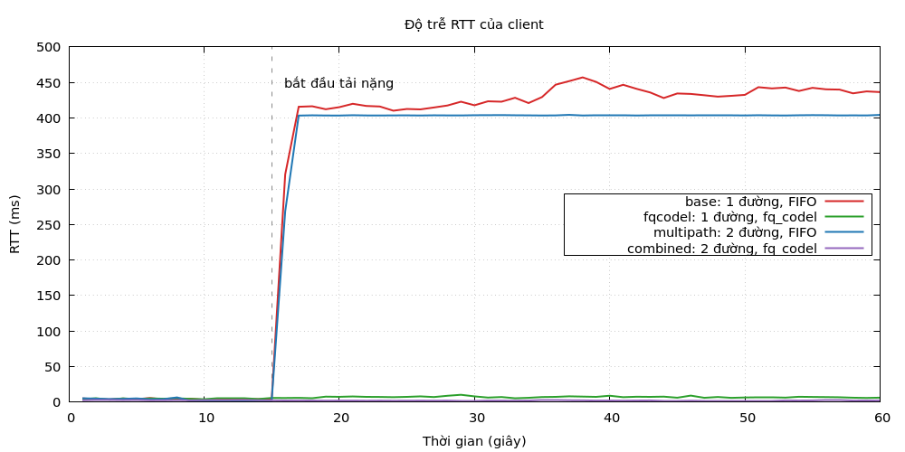
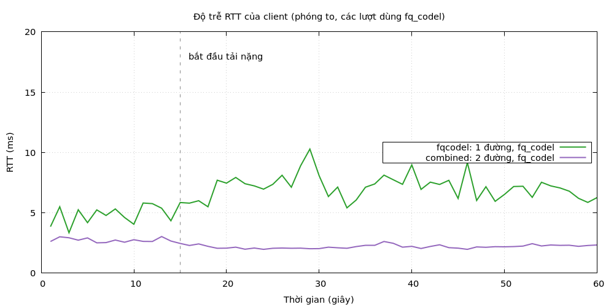
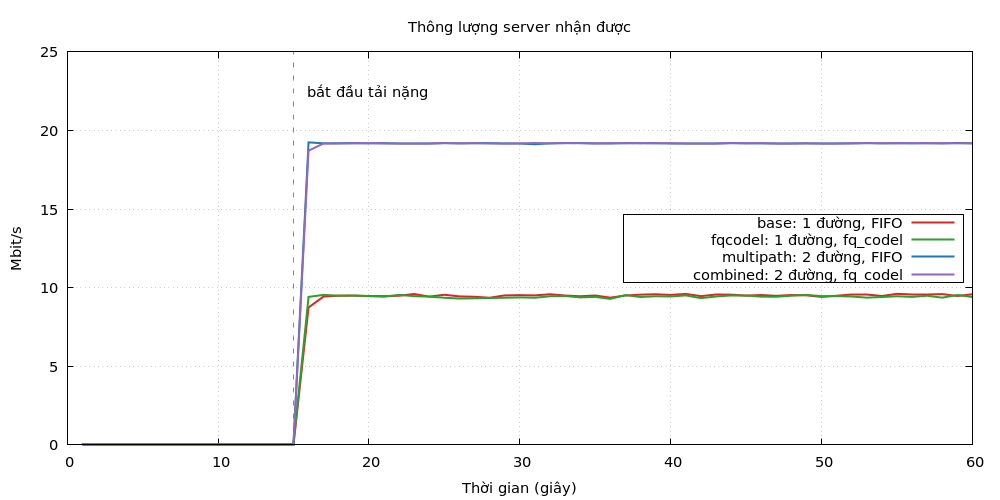
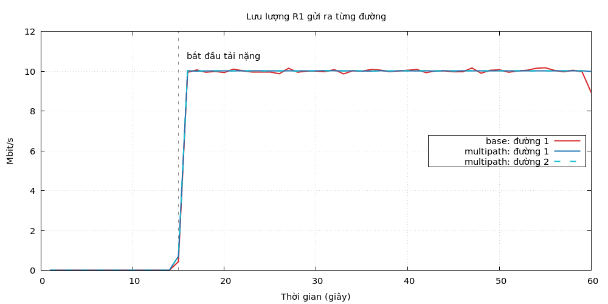

# Cải thiện hiệu năng mạng: giảm độ trễ và tăng băng thông

Đồ án chạy trên EVE-NG, các node là máy Linux (Alpine), chương trình đo đạc viết bằng C.

Một máy tải nặng (`loadgen`, mô phỏng tải file, xem video) chạy chung đường với một người dùng bình thường (`client`, mô phỏng thao tác cần phản hồi nhanh). Khi đường truyền bị dùng hết, người dùng bình thường bị chậm. Đồ án cải thiện theo hai hướng, cả hai đều chỉ thay đổi cách router **chọn đường và chuyển tiếp** gói:

| Hướng | Vấn đề | Giải pháp trên router |
|---|---|---|
| **Giảm độ trễ** | Hàng đợi FIFO dồn đầy gói của luồng tải nặng, gói của client phải xếp sau, chờ khoảng 400 ms | Đổi hàng đợi sang **fq_codel**: chia hàng đợi theo từng luồng, gửi xoay vòng giữa các luồng, chủ động bỏ bớt gói khi gói chờ quá lâu |
| **Tăng băng thông** | Chỉ dùng một đường 10 Mbit/s trong khi còn một đường khác để không | **Định tuyến nhiều đường (ECMP)**: R1 và R3 chia các luồng ra cả hai đường, tổng băng thông lên 20 Mbit/s |

---

## 1. Kết quả đo trên EVE-NG

Mỗi lượt 60 giây, tải nặng bắt đầu ở giây 15. Lấy từ `scripts/plot.sh results/eve-v4`:

| Lượt | Số đường | Hàng đợi | RTT chưa tải | RTT có tải | Jitter có tải | Mất gói | Server nhận được |
|---|---|---|---|---|---|---|---|
| **base** | 1 | FIFO | 4,3 ms | **430 ms** | 2,6 ms | 0% | **9,4 Mbit/s** |
| **fqcodel** | 1 | fq_codel | 4,9 ms | **7,2 ms** | 3,6 ms | 0% | 9,4 Mbit/s |
| **multipath** | 2 | FIFO | 3,5 ms | 404 ms | 0,7 ms | 0% | **18,9 Mbit/s** |
| **combined** | 2 | fq_codel | 2,7 ms | **2,2 ms** | 0,6 ms | 0% | **19,2 Mbit/s** |

- **fq_codel giảm độ trễ:** RTT lúc có tải giảm từ 430 ms xuống 7 ms, gần bằng lúc chưa có tải.
- **Hai đường tăng băng thông:** thông lượng server nhận được tăng gấp đôi, từ 9,4 lên 18,9 Mbit/s. Mỗi đường chạy đủ 10 Mbit/s.
- **Kết hợp cả hai:** vừa có 19,2 Mbit/s, vừa giữ RTT khoảng 2 ms.
- Chỉ thêm đường mà không đổi hàng đợi thì băng thông tăng nhưng độ trễ không giảm, vì tải nặng vẫn làm đầy hàng đợi của mỗi đường. Hai giải pháp bổ sung cho nhau.
- Client không mất gói vì hàng đợi FIFO giới hạn theo byte: gói tải 1000 byte bị bỏ khi hàng đợi đầy, truy vấn nhỏ của client vẫn chen vào được nhưng phải chờ.
- RTT lúc chưa tải khác nhau giữa các lượt (2,7 tới 4,9 ms) vì 6 máy ảo chạy chung CPU của laptop.






---

## 2. Mô hình mạng

```
                                        đường 1: 10 Mbit/s
                          ┌──── R2 ────────────────────────┐
 Loadgen 10.0.1.10 ─┐     │ 10.0.12.0/24     10.0.23.0/24  │
                    ├── R1                                 R3 ── Server 10.0.3.10
 Client  10.0.1.20 ─┘     │         10.0.13.0/24           │
                          └────────────────────────────────┘
                                        đường 2: 10 Mbit/s
```

- **Đường 1:** R1 → R2 → R3. **Đường 2:** R1 → R3 nối thẳng.
- Mọi link giữa hai router bị giới hạn 10 Mbit/s bằng `tc tbf` để tạo đường truyền có băng thông hữu hạn.
- Loadgen gửi khoảng 40 Mbit/s, gấp 4 lần một đường, chia làm 8 luồng UDP.

### 2.1. Địa chỉ IP

| Node | Card | IP | Ghi chú |
|---|---|---|---|
| Loadgen | eth1 | 10.0.1.10/24 | gateway 10.0.1.1 |
| Client | eth1 | 10.0.1.20/24 | gateway 10.0.1.1 |
| R1 | eth1 / eth2 / eth3 | 10.0.1.1 / 10.0.12.1 / 10.0.13.1 | eth2 = đường 1, eth3 = đường 2 |
| R2 | eth1 / eth2 | 10.0.12.2 / 10.0.23.2 | router giữa đường 1 |
| R3 | eth1 / eth2 / eth3 | 10.0.23.3 / 10.0.3.1 / 10.0.13.3 | eth1 = đường 1, eth3 = đường 2 |
| Server | eth1 | 10.0.3.10/24 | gateway 10.0.3.1 |

Mỗi node còn có `eth0` thuộc mạng quản lý 172.30.0.0/24 (máy EVE là .1, node 1..6 là .11 tới .16), chỉ dùng để SSH điều khiển, không tham gia đo.

### 2.2. Định tuyến

| Router | Đích | 1 đường | 2 đường |
|---|---|---|---|
| R1 | 10.0.3.0/24 (server) | qua 10.0.12.2 (R2) | qua 10.0.12.2 **và** 10.0.13.3 (R3), cùng trọng số |
| R3 | 10.0.1.0/24 (client) | qua 10.0.23.2 (R2) | qua 10.0.23.2 **và** 10.0.13.1 (R1), cùng trọng số |
| R2 | 10.0.1.0/24, 10.0.3.0/24 | qua R1, qua R3 | như cũ |

Với 2 đường, Linux chọn đường cho **từng luồng** theo IP và cổng nguồn/đích (`net.ipv4.fib_multipath_hash_policy=1`). Gói của cùng một luồng luôn đi cùng một đường nên không bị đảo thứ tự. Loadgen dùng 8 cổng nguồn 20000–20007 nên các luồng được chia ra cả hai đường.

### 2.3. Hàng đợi trên link giữa router

| Kiểu | Cấu hình `tc` | Hoạt động |
|---|---|---|
| **fifo** | `tbf rate 10mbit latency 400ms` | Một hàng đợi chung khoảng 500KB. Gói tới sau xếp sau tất cả, đầy thì bỏ gói mới |
| **fq_codel** | `tbf rate 10mbit` + con `fq_codel` | Mỗi luồng một hàng riêng, gửi xoay vòng nên luồng nhỏ không phải chờ luồng lớn. Gói nào chờ quá 5 ms liên tục thì bị bỏ bớt, giữ hàng đợi luôn ngắn |

Cấu hình nằm trong `lab/r1.sh`, `lab/r2.sh`, `lab/r3.sh`. Mỗi file nhận 2 tham số: `sh r1.sh <fifo|fqcodel> <1|2>`.

---

## 3. Cấu trúc thư mục

| Đường dẫn | Nội dung |
|---|---|
| `src/server.c` | Server: trả lời truy vấn của client, đếm thông lượng nhận được mỗi giây |
| `src/client.c` | Client: gửi 20 truy vấn/giây, đo RTT, jitter, mất gói |
| `src/loadgen.c` | Máy tải nặng: gửi UDP tốc độ cố định, chia nhiều luồng |
| `src/proto.c`, `src/stats.c` | Định dạng gói, tính RTT/jitter/mất gói (dùng chung) |
| `tests/` | Unit test, chạy bằng `make test` |
| `lab/<node>.sh` | IP, route, hàng đợi của từng node |
| `lab/eve-make-image.sh`, `lab/eve-create-lab.sh` | Tạo image Alpine và lab `net-perf` trong EVE (chạy một lần) |
| `lab/netns-up.sh`, `lab/netns-down.sh` | Mini-lab dự phòng bằng network namespace |
| `scripts/lab-up.sh` | Chuẩn bị lab trước giờ demo, in `SẴN SÀNG` khi mọi thứ ổn |
| `scripts/demo.sh <lượt>` | Chạy một lượt 60 giây, ghi kết quả vào `results/` |
| `scripts/tmux-demo.sh <lượt>` | Màn hình demo 4 ô |
| `scripts/run-all.sh` | Chạy liên tiếp 4 lượt rồi vẽ biểu đồ |
| `scripts/plot.sh` | Vẽ biểu đồ và in bảng so sánh |
| `scripts/reset.sh` | Dừng mọi chương trình đo trên các node |
| `results/eve-v4/` | Kết quả một lần chạy đủ 4 lượt trên EVE |

---

## 4. Cài đặt (làm một lần)

Mọi script đều chạy **bên trong máy ảo EVE-NG** (Ubuntu 22.04). Máy thật chỉ cần phần mềm máy ảo, trình duyệt và `ssh`. Cách cài EVE trên Windows xem `CAI-DAT-WINDOWS.md`.

Cấu hình tối thiểu: RAM 16GB, ổ trống 70GB, CPU bật ảo hóa (VT-x hoặc AMD-V).

**Cài EVE trên Ubuntu (KVM):**

```
sudo apt-get install -y qemu-kvm libvirt-daemon-system libvirt-clients virtinst virt-manager
sudo usermod -aG libvirt,kvm $USER     # rồi đăng xuất, đăng nhập lại
virt-install --connect qemu:///system --name eve-ng --memory 6144 --vcpus 4 \
  --cpu host-passthrough --disk size=60,format=qcow2 \
  --cdrom ~/Downloads/eve-ce-prod-6.2.0-4-full.iso \
  --network network=default --os-variant ubuntu22.04 --graphics spice --noautoconsole
```

Cài EVE trong máy ảo: chọn **Install EVE VM**, để mặc định; đăng nhập `root` / `eve`, chọn IP **dhcp**. Màn hình đăng nhập hiện IP của EVE (dưới đây viết là `<EVE_IP>`). Web: `http://<EVE_IP>`, tài khoản `admin` / `eve`.

**Đưa dự án vào EVE và dựng lab:**

```
ssh-copy-id root@<EVE_IP>
scp -r onejack root@<EVE_IP>:/root/
ssh root@<EVE_IP>
cd /root/onejack
apt-get install -y gnuplot-nox
make && make test                   # build 3 chương trình C (biên dịch tĩnh)
bash lab/eve-make-image.sh          # tạo image Alpine, khoảng 2 phút
bash lab/eve-create-lab.sh          # tạo lab net-perf 6 node và bật lên
scripts/lab-up.sh                   # cấu hình node, kiểm tra, phải in SẴN SÀNG
```

---

## 5. Chạy demo

```
virsh -c qemu:///system start eve-ng      # Windows: Power on trong VMware
ssh root@<EVE_IP>
cd /root/onejack
scripts/lab-up.sh                         # khoảng 40 giây, phải in SẴN SÀNG
```

Chạy từng lượt trên màn hình demo (mỗi lượt 60 giây, tải nặng bắt đầu ở giây 15, xong gõ `exit`):

```
scripts/tmux-demo.sh base        # 1 đường, FIFO: mốc so sánh
scripts/tmux-demo.sh fqcodel     # 1 đường, fq_codel: giảm độ trễ
scripts/tmux-demo.sh multipath   # 2 đường, FIFO: tăng băng thông
scripts/tmux-demo.sh combined    # 2 đường, fq_codel: cả hai
scripts/plot.sh                  # vẽ biểu đồ, in bảng so sánh
```

Hoặc chạy cả 4 lượt liền một lèo, không có màn hình demo: `scripts/run-all.sh`.

Màn hình demo chia 4 ô:

| Vị trí | Hiển thị |
|---|---|
| Trên trái | RTT, jitter, mất gói của client mỗi giây |
| Dưới trái | Lưu lượng R1 gửi ra đường 1 và đường 2 |
| Trên phải | Thông lượng server nhận được |
| Dưới phải | Tiến trình `demo.sh`: cấu hình router, lúc bắt đầu tải |

Biểu đồ nằm ở `results/*.png`. Lấy về máy thật: `scp root@<EVE_IP>:/root/onejack/results/*.png .`

Muốn đổi thông số (thời gian, tốc độ tải, số luồng), sửa phần đầu `scripts/demo.sh`.

---

## 6. Phương án dự phòng

**Mini-lab bằng network namespace**, cùng mô hình nhưng không cần máy ảo node. Chạy được trên Ubuntu thật (thêm `sudo`) hoặc trong máy ảo EVE:

```
lab/netns-up.sh
LAB=netns scripts/lab-up.sh
LAB=netns scripts/tmux-demo.sh base
LAB=netns scripts/run-all.sh
lab/netns-down.sh
```

**Biểu đồ có sẵn** trong `results/eve-v4/`.

---

## 7. Hạn chế và hướng phát triển

1. **Chia đường theo luồng, không theo gói.** Một luồng đơn lẻ chỉ dùng được một đường, tối đa 10 Mbit/s. Muốn một luồng dùng cả hai đường cần giao thức nhiều đường như MPTCP.
2. **Hai đường có cùng tốc độ.** Khi hai đường khác tốc độ cần đặt trọng số theo băng thông (`weight` của `ip route`).
3. **Đường được cấu hình tĩnh.** Khi một đường đứt, route không tự đổi. Có thể chạy giao thức định tuyến động (OSPF) để router tự cập nhật.
4. **Lưu lượng mô phỏng bằng UDP tốc độ cố định**, chưa có TCP tự điều chỉnh tốc độ như tải file thật.
5. **Môi trường ảo trên một laptop**, các con số tuyệt đối sẽ khác trên thiết bị thật, nhưng xu hướng so sánh giữa các lượt vẫn đúng.

---

## 8. Checklist trước giờ trình bày

- [ ] Tắt các ứng dụng nặng. Bật máy ảo EVE trước 10 phút.
- [ ] `ssh root@<EVE_IP>`, `cd /root/onejack`, chạy `scripts/lab-up.sh` và thấy `SẴN SÀNG`.
- [ ] Tập chạy `scripts/tmux-demo.sh base` một lần.
- [ ] Phóng to chữ terminal (Ctrl + Shift + +).
- [ ] Mở sẵn web EVE, lab `net-perf`, để chỉ sơ đồ mạng.
- [ ] Để sẵn biểu đồ trong `results/eve-v4/`.
