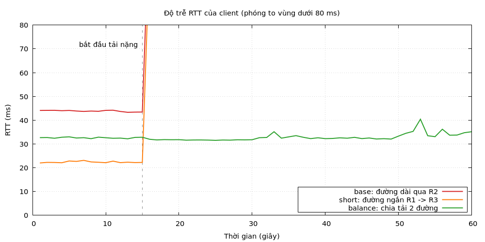

# Cải thiện hiệu năng mạng: giảm độ trễ

Đồ án chạy trên EVE-NG, các node là máy Linux (Alpine), chương trình đo đạc viết bằng C.

**Độ trễ** là thời gian dữ liệu đi từ máy gửi tới máy nhận. Trong đồ án, độ trễ được đo bằng **RTT** (round-trip time): thời gian client gửi một truy vấn tới server và nhận lại trả lời.

Một máy tải nặng (`loadgen`, mô phỏng tải file, xem video) dùng chung mạng với một người dùng bình thường (`client`, mô phỏng gọi video, chơi game, cần phản hồi nhanh). Giữa hai đầu mạng có hai đường đi:

- **Đường dài:** R1 → R2 → R3, đi qua thêm một router trung gian.
- **Đường ngắn:** R1 → R3, nối thẳng.

Đồ án so sánh ba cách router **chọn đường** để chuyển tiếp gói, đúng với các cách giảm độ trễ:

| Lượt | Router chọn đường thế nào | Cách giảm độ trễ tương ứng |
|---|---|---|
| **base** | Mọi lưu lượng đi đường dài | Mốc so sánh |
| **short** | Mọi lưu lượng đi đường ngắn | Dùng tuyến đường ngắn hơn, giảm số thiết bị trung gian |
| **balance** | Chia các luồng ra cả hai đường | Phân phối tải để không đường nào bị quá tải, dùng tuyến ít tắc nghẽn |

---

## 1. Kết quả đo trên EVE-NG

Mỗi lượt 60 giây. Tải nặng 12 Mbit/s bắt đầu ở giây 15, vượt băng thông 10 Mbit/s của một đường. Lấy từ `scripts/plot.sh results/eve`:

| Lượt | RTT chưa có tải | RTT khi có tải | Jitter khi có tải | Client mất gói | Server nhận được |
|---|---|---|---|---|---|
| **base** | 43,9 ms | **455,9 ms** | 1,4 ms | 0% | 9,6 / 12 Mbit/s |
| **short** | **22,4 ms** | 421,6 ms | 1,3 ms | 0% | 9,6 / 12 Mbit/s |
| **balance** | 32,6 ms | **32,9 ms** | 1,1 ms | 0% | **11,7 / 12 Mbit/s** |

- **Đường ngắn giảm độ trễ lúc mạng thông thoáng:** RTT từ 43,9 ms còn 22,4 ms, gần một nửa, vì gói đi qua ít link và ít router hơn.
- **Nhưng đường ngắn không giúp được khi bị tắc nghẽn:** tải 12 Mbit/s dồn vào một đường 10 Mbit/s, gói phải xếp hàng chờ khoảng 400 ms. Đây là phần lớn nhất của độ trễ.
- **Phân phối tải giải quyết tắc nghẽn:** tải chia ra hai đường (khoảng 6,7 và 5,9 Mbit/s), không đường nào quá tải nên không có hàng chờ. RTT khi có tải gần như bằng lúc chưa có tải: 32,9 ms so với 455,9 ms ở lượt base, **giảm khoảng 93%**. Server cũng nhận gần đủ 12 Mbit/s thay vì bị bỏ mất khoảng 20%.
- RTT lúc chưa tải ở lượt balance (32,6 ms) nằm giữa hai đường, vì chiều đi và chiều về của client được chia vào hai đường khác nhau.
- Client không mất gói vì hàng đợi giới hạn theo byte: gói tải 1000 byte bị bỏ khi hàng đầy, truy vấn nhỏ của client vẫn chen vào được nhưng phải chờ.





---

## 2. Mô hình mạng

```
                                    đường dài: 2 link, qua R2
                          ┌──── R2 ────────────────────────┐
 Loadgen 10.0.1.10 ─┐     │ 10.0.12.0/24     10.0.23.0/24  │
                    ├── R1                                 R3 ── Server 10.0.3.10
 Client  10.0.1.20 ─┘     │         10.0.13.0/24           │
                          └────────────────────────────────┘
                                    đường ngắn: 1 link
```

Mỗi link giữa hai router được cấu hình:
- **Độ trễ truyền 10 ms** mỗi chiều (`tc netem`), mô phỏng khoảng cách địa lý. Đường dài có 2 link nên RTT nền khoảng 40 ms, đường ngắn 1 link nên khoảng 20 ms.
- **Băng thông 10 Mbit/s** (`tc tbf`), hàng đợi tối đa 500KB, tức khoảng 400 ms nếu đầy.

### 2.1. Địa chỉ IP

| Node | Card | IP | Ghi chú |
|---|---|---|---|
| Loadgen | eth1 | 10.0.1.10/24 | gateway 10.0.1.1 |
| Client | eth1 | 10.0.1.20/24 | gateway 10.0.1.1 |
| R1 | eth1 / eth2 / eth3 | 10.0.1.1 / 10.0.12.1 / 10.0.13.1 | eth2 = đường dài, eth3 = đường ngắn |
| R2 | eth1 / eth2 | 10.0.12.2 / 10.0.23.2 | router trung gian của đường dài |
| R3 | eth1 / eth2 / eth3 | 10.0.23.3 / 10.0.3.1 / 10.0.13.3 | eth1 = đường dài, eth3 = đường ngắn |
| Server | eth1 | 10.0.3.10/24 | gateway 10.0.3.1 |

Mỗi node còn có `eth0` thuộc mạng quản lý 172.30.0.0/24 (máy EVE là .1, node 1..6 là .11 tới .16), chỉ dùng để SSH điều khiển, không tham gia đo.

### 2.2. Định tuyến ở từng lượt

| Router | Đích | base | short | balance |
|---|---|---|---|---|
| R1 | 10.0.3.0/24 (server) | qua 10.0.12.2 (R2) | qua 10.0.13.3 (R3) | qua cả hai, cùng trọng số |
| R3 | 10.0.1.0/24 (client) | qua 10.0.23.2 (R2) | qua 10.0.13.1 (R1) | qua cả hai, cùng trọng số |
| R2 | cả hai phía | cố định | cố định | cố định |

Khi chia tải, Linux chọn đường cho **từng luồng** dựa trên IP và cổng nguồn/đích (`net.ipv4.fib_multipath_hash_policy=1`). Gói của cùng một luồng luôn đi cùng một đường nên không bị đảo thứ tự. Loadgen dùng 32 luồng (cổng nguồn 20000–20031), nên tải được chia gần đều ra hai đường.

Cấu hình nằm trong `lab/r1.sh`, `lab/r2.sh`, `lab/r3.sh`. Ví dụ: `sh r1.sh balance`.

---

## 3. Cấu trúc thư mục

| Đường dẫn | Nội dung |
|---|---|
| `src/server.c` | Server: trả lời truy vấn của client, đếm thông lượng nhận được mỗi giây |
| `src/client.c` | Client: gửi 20 truy vấn/giây, đo RTT, jitter, mất gói |
| `src/loadgen.c` | Máy tải nặng: gửi UDP tốc độ cố định, chia nhiều luồng |
| `src/proto.c`, `src/stats.c` | Định dạng gói, tính RTT/jitter/mất gói (dùng chung) |
| `tests/` | Unit test, chạy bằng `make test` |
| `lab/<node>.sh` | IP, route, độ trễ và băng thông link của từng node |
| `lab/eve-make-image.sh`, `lab/eve-create-lab.sh` | Tạo image Alpine và lab `net-perf` trong EVE (chạy một lần) |
| `lab/netns-up.sh`, `lab/netns-down.sh` | Mini-lab dự phòng bằng network namespace |
| `scripts/lab-up.sh` | Chuẩn bị lab trước giờ demo, in `SẴN SÀNG` khi mọi thứ ổn |
| `scripts/demo.sh <lượt>` | Chạy một lượt 60 giây, ghi kết quả vào `results/` |
| `scripts/tmux-demo.sh <lượt>` | Màn hình demo 4 ô |
| `scripts/run-all.sh` | Chạy liên tiếp 3 lượt rồi vẽ biểu đồ |
| `scripts/plot.sh` | Vẽ biểu đồ và in bảng so sánh |
| `scripts/reset.sh` | Dừng mọi chương trình đo trên các node |
| `results/eve/` | Kết quả một lần chạy đủ 3 lượt trên EVE |

---

## 4. Cài đặt (làm một lần)

Mọi script đều chạy **bên trong máy ảo EVE-NG** (Ubuntu 22.04). Máy thật chỉ cần phần mềm máy ảo, trình duyệt và `ssh`. Cách cài EVE trên Windows xem `CAI-DAT-WINDOWS.md`.

Cấu hình tối thiểu: RAM 16GB, ổ trống 70GB, CPU bật ảo hóa (VT-x hoặc AMD-V).

**Cài EVE trên Ubuntu (KVM):**

```
sudo apt-get install -y qemu-kvm libvirt-daemon-system libvirt-clients virtinst virt-manager
sudo usermod -aG libvirt,kvm $USER     # rồi đăng xuất, đăng nhập lại
virt-install --connect qemu:///system --name eve-ng --memory 6144 --vcpus 4 \
  --cpu host-passthrough --disk size=60,format=qcow2 \
  --cdrom ~/Downloads/eve-ce-prod-6.2.0-4-full.iso \
  --network network=default --os-variant ubuntu22.04 --graphics spice --noautoconsole
```

Cài EVE trong máy ảo: chọn **Install EVE VM**, để mặc định; đăng nhập `root` / `eve`, chọn IP **dhcp**. Màn hình đăng nhập hiện IP của EVE (dưới đây viết là `<EVE_IP>`). Web: `http://<EVE_IP>`, tài khoản `admin` / `eve`.

**Đưa dự án vào EVE và dựng lab:**

```
ssh-copy-id root@<EVE_IP>
scp -r onejack root@<EVE_IP>:/root/
ssh root@<EVE_IP>
cd /root/onejack
apt-get install -y gnuplot-nox
make && make test                   # build 3 chương trình C (biên dịch tĩnh)
bash lab/eve-make-image.sh          # tạo image Alpine, khoảng 2 phút
bash lab/eve-create-lab.sh          # tạo lab net-perf 6 node và bật lên
scripts/lab-up.sh                   # cấu hình node, kiểm tra, phải in SẴN SÀNG
```

---

## 5. Chạy demo

```
virsh -c qemu:///system start eve-ng      # Windows: Power on trong VMware
ssh root@<EVE_IP>
cd /root/onejack
scripts/lab-up.sh                         # khoảng 40 giây, phải in SẴN SÀNG
```

Chạy từng lượt trên màn hình demo (mỗi lượt 60 giây, tải nặng bắt đầu ở giây 15, xong gõ `exit`):

```
scripts/tmux-demo.sh base        # mọi lưu lượng đi đường dài
scripts/tmux-demo.sh short       # mọi lưu lượng đi đường ngắn
scripts/tmux-demo.sh balance     # chia tải ra hai đường
scripts/plot.sh                  # vẽ biểu đồ, in bảng so sánh
```

Hoặc chạy cả 3 lượt liền một lèo, không có màn hình demo: `scripts/run-all.sh`.

Màn hình demo chia 4 ô:

| Vị trí | Hiển thị |
|---|---|
| Trên trái | RTT, jitter, mất gói của client mỗi giây |
| Dưới trái | Lưu lượng R1 gửi ra đường dài và đường ngắn |
| Trên phải | Thông lượng server nhận được |
| Dưới phải | Tiến trình `demo.sh`: đường đi đang dùng, lúc bắt đầu tải |

Biểu đồ nằm ở `results/*.png`. Lấy về máy thật: `scp root@<EVE_IP>:/root/onejack/results/*.png .`

Muốn đổi thông số (thời gian, tốc độ tải, số luồng), sửa phần đầu `scripts/demo.sh`. Muốn đổi độ trễ hoặc băng thông link, đặt biến `LINK_DELAY`, `LINK_RATE` khi chạy `lab/<router>.sh`.

---

## 6. Phương án dự phòng

**Mini-lab bằng network namespace**, cùng mô hình nhưng không cần máy ảo node. Chạy được trên Ubuntu thật (thêm `sudo`) hoặc trong máy ảo EVE:

```
lab/netns-up.sh
LAB=netns scripts/lab-up.sh
LAB=netns scripts/tmux-demo.sh base
LAB=netns scripts/run-all.sh
lab/netns-down.sh
```

**Biểu đồ có sẵn** trong `results/eve/`.

---

## 7. Hạn chế và hướng phát triển

1. **Đường đi được cấu hình tĩnh.** Router không tự biết đường nào đang tắc để đổi. Hướng phát triển: chạy giao thức định tuyến động (OSPF) hoặc đo độ trễ từng đường rồi tự chọn.
2. **Chia tải theo luồng.** Một luồng đơn lẻ chỉ đi được một đường. Nếu chỉ có vài luồng lớn, tải có thể chia lệch.
3. **Hai đường cùng băng thông.** Khi hai đường khác băng thông cần đặt trọng số tương ứng (`weight` của `ip route`).
4. **Lưu lượng mô phỏng bằng UDP tốc độ cố định**, chưa có TCP tự điều chỉnh tốc độ như tải file thật.
5. **Môi trường ảo trên một laptop**, độ trễ truyền 10 ms là giá trị giả lập. Con số tuyệt đối sẽ khác trên thiết bị thật, nhưng xu hướng so sánh giữa các lượt vẫn đúng.

---

## 8. Checklist trước giờ trình bày

- [ ] Tắt các ứng dụng nặng. Bật máy ảo EVE trước 10 phút.
- [ ] `ssh root@<EVE_IP>`, `cd /root/onejack`, chạy `scripts/lab-up.sh` và thấy `SẴN SÀNG`.
- [ ] Tập chạy `scripts/tmux-demo.sh base` một lần.
- [ ] Phóng to chữ terminal (Ctrl + Shift + +).
- [ ] Mở sẵn web EVE, lab `net-perf`, để chỉ sơ đồ mạng.
- [ ] Để sẵn biểu đồ trong `results/eve/`.
