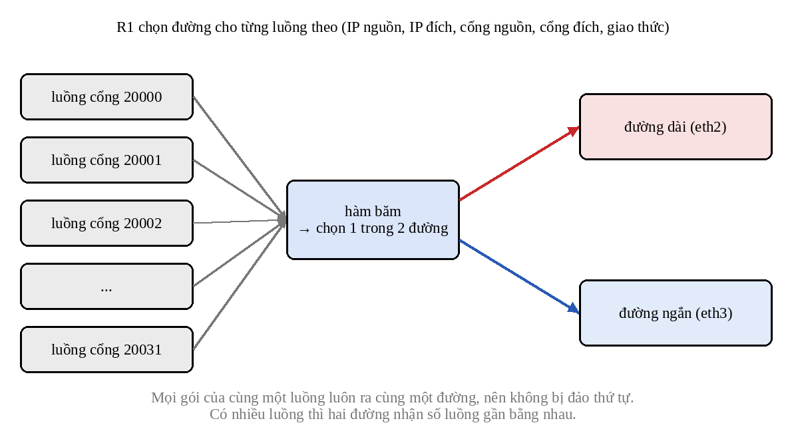

# CƠ SỞ LÝ THUYẾT

## Hiệu năng mạng

### Hiệu năng mạng và yêu cầu của ứng dụng

Hiệu năng mạng cho biết mạng đáp ứng nhu cầu truyền dữ liệu của người dùng tốt tới đâu, chẳng hạn dữ liệu có tới đủ không, có nhanh không và có đều không. Vì vậy hiệu năng thường được đánh giá qua nhiều thông số, mỗi thông số cho thấy một mặt khác nhau [[REF:6]] [[REF:9]].

Mỗi loại ứng dụng quan tâm tới một thông số khác nhau. Khi tải tệp, người dùng cần tốc độ cao, còn chờ thêm vài trăm mili giây cũng không ảnh hưởng gì. Ngược lại, gọi thoại, họp trực tuyến hay chơi trò chơi trực tuyến chỉ cần lưu lượng nhỏ nhưng rất nhạy với độ trễ. Đề tài hướng tới nhóm ứng dụng thứ hai nên lấy độ trễ làm thông số đánh giá chính.

### Yếu tố quyết định hiệu năng của kết nối

Hiệu năng của một kết nối phụ thuộc chủ yếu vào các yếu tố sau:

- Băng thông của các đường truyền trên đường đi, nhất là đoạn có băng thông nhỏ nhất.
- Độ dài đường đi, tức gói phải đi qua bao nhiêu đoạn đường truyền và bao nhiêu thiết bị trung gian.
- Mức tải, là tổng lưu lượng của mọi người dùng cùng đi qua một đường truyền. Tải vượt băng thông thì đường truyền bị tắc nghẽn.
- Năng lực xử lý của thiết bị, tức router đọc tiêu đề gói, tra bảng định tuyến và chuyển tiếp nhanh hay chậm.
- Cách router chọn đường. Cùng một hạ tầng, nhưng lưu lượng dồn vào một đường hay được chia đều sẽ cho kết quả rất khác nhau.

Trong đề tài, băng thông, độ dài từng đường và thiết bị được giữ nguyên, chỉ có cách router chọn đường là thay đổi.

## Các chỉ số đo hiệu năng

### Băng thông và thông lượng

**Băng thông** (bandwidth) là lượng dữ liệu tối đa một đường truyền có thể chở trong một giây, tính bằng bit/giây. Trong đề tài, mỗi đoạn đường truyền giữa hai router có băng thông {{link_rate}} Mbit/s.

**Thông lượng** (throughput) là lượng dữ liệu thực tế truyền được trong một giây. Thông lượng không thể vượt băng thông. Nếu lưu lượng gửi vào lớn hơn băng thông thì thông lượng chỉ lên tới mức băng thông, phần dư phải nằm chờ trong hàng đợi hoặc bị loại bỏ.

### Độ trễ và thời gian khứ hồi

Độ trễ là thời gian một gói đi từ máy gửi tới máy nhận. Trên mỗi chặng, tức mỗi lần gói đi qua một router và một đoạn đường truyền, độ trễ gồm bốn thành phần [[REF:6]], minh họa ở hình dưới.


- **Độ trễ xử lý:** thời gian router đọc tiêu đề gói và chọn cổng ra. Trên router hiện nay, thời gian này rất nhỏ.
- **Độ trễ xếp hàng:** thời gian gói nằm trong hàng đợi chờ tới lượt. Khi đường truyền rảnh, thời gian này gần như bằng 0; khi đường truyền quá tải, nó tăng rất nhanh.
- **Độ trễ phát:** thời gian đẩy toàn bộ các bit của gói lên đường truyền, bằng kích thước gói chia cho băng thông.
- **Độ trễ truyền:** thời gian tín hiệu đi hết chiều dài đường truyền, phụ thuộc vào khoảng cách. Đường càng dài, càng nhiều chặng thì tổng độ trễ truyền càng lớn.

Độ trễ của cả đường đi bằng tổng độ trễ của các chặng. **Thời gian khứ hồi RTT** là thời gian gói đi tới máy nhận cộng với thời gian trả lời quay về [[REF:1]]. RTT dễ đo hơn độ trễ một chiều vì chỉ cần đồng hồ của một máy, nên đề tài dùng RTT làm thước đo chính.

### Độ biến động của độ trễ (jitter)

Jitter cho biết độ trễ của các gói liên tiếp chênh nhau nhiều hay ít. Cùng một độ trễ trung bình, nhưng nếu jitter lớn thì có gói tới sớm, có gói tới muộn, làm âm thanh và hình ảnh bị ngắt quãng. RFC 3393 định nghĩa biến thiên độ trễ là hiệu độ trễ của các cặp gói [[REF:2]], còn RFC 3550 dùng một cách ước lượng jitter tương tự cho luồng thoại và video [[REF:8]].

Trong đề tài, jitter được tính đơn giản hơn: tại client, lấy trung bình độ lệch tuyệt đối giữa RTT của hai trả lời liên tiếp. Cách tính này cùng ý tưởng với RFC 3393 nhưng dùng RTT thay cho độ trễ một chiều, nên không cần đồng bộ đồng hồ giữa hai máy.

### Mất gói tin

Tỷ lệ mất gói là phần trăm số gói gửi đi nhưng không tới được nơi nhận. Lý do hay gặp nhất là hàng đợi của router đã đầy nên gói mới tới bị bỏ. Trong đề tài, một truy vấn của client bị tính là mất nếu sau một giây vẫn chưa có trả lời.

### Quan hệ giữa tải, độ trễ và mất gói

Các thông số trên liên quan chặt với nhau. Khi lưu lượng gửi vào còn nhỏ hơn băng thông, thông lượng tăng theo lưu lượng, hàng đợi gần như trống và độ trễ chủ yếu chỉ gồm thời gian truyền, phát và xử lý. Khi lưu lượng vượt băng thông, thông lượng dừng ở mức băng thông, hàng đợi đầy dần và độ trễ xếp hàng tăng vọt. Tới lúc hàng đợi đầy hẳn thì gói bắt đầu bị bỏ, tỷ lệ mất gói tăng lên. Vì thế, muốn giữ độ trễ thấp thì trước hết phải tránh để đường truyền vượt băng thông.

## Tắc nghẽn và hàng đợi trên router

### Hiện tượng tắc nghẽn

Tắc nghẽn xảy ra khi tổng lưu lượng muốn đi qua một đường truyền lớn hơn băng thông của nó. Router không gửi nhanh hơn băng thông được, nên phần dư phải chờ hoặc bị bỏ. Tắc nghẽn có thể do một máy gửi quá nhiều, như máy tạo tải trong đề tài, hoặc do nhiều người dùng cùng đi chung một đường truyền.

Khi đã tắc nghẽn thì mọi người dùng đi chung đường truyền đều bị ảnh hưởng, kể cả người gửi rất ít dữ liệu. Trong đề tài, client chỉ gửi vài chục truy vấn nhỏ mỗi giây, nhưng vì đi chung đường với loadgen nên truy vấn của client vẫn phải chờ trong cùng một hàng đợi.

### Hàng đợi FIFO và độ trễ xếp hàng

Mỗi cổng ra của router có một hàng đợi. Loại đơn giản nhất hoạt động theo kiểu vào trước ra trước (First In First Out – FIFO): gói tới trước được gửi trước, gói tới sau xếp phía sau.


Khi hàng đợi đã đầy, một gói mới vào phải chờ một khoảng bằng dung lượng hàng đợi chia cho băng thông. Với hàng đợi {{queue_kb}}KB và băng thông {{link_rate}} Mbit/s, thời gian chờ là {{queue_kb}} × 1000 × 8 / ({{link_rate}} × 1.000.000) giây, tức khoảng {{queue_delay_ms}} mili giây. Con số này lớn hơn nhiều so với độ trễ truyền {{link_delay}} mili giây của mỗi đoạn đường truyền.

Hàng đợi trong đề tài được giới hạn theo số byte chứ không theo số gói. Khi hàng gần đầy, gói tải lớn tới sau bị bỏ, còn truy vấn rất nhỏ của client vẫn chen được vào chỗ trống. Do đó client thường không mất gói mà chỉ phải chờ lâu.

## Các hướng giảm độ trễ

Dựa vào các thành phần của độ trễ ở trên, có thể giảm độ trễ theo một số hướng sau.

### Chọn đường ngắn hơn

Nếu giữa hai điểm có nhiều đường đi, chọn đường ngắn hơn sẽ giảm được tổng độ trễ truyền. Trong định tuyến, router thường chọn đường có chi phí nhỏ nhất, với chi phí tính theo số chặng, theo băng thông hoặc theo độ trễ của từng đường truyền [[REF:9]].

Tuy vậy, đường ngắn chỉ có lợi khi nó không bị tắc. Nếu mọi lưu lượng đều dồn vào đường ngắn và vượt băng thông, thời gian xếp hàng sẽ lớn hơn nhiều so với phần độ trễ truyền tiết kiệm được.

### Giảm số router trung gian

Mỗi thiết bị trung gian lại thêm một lần xử lý, một hàng đợi và một đoạn đường truyền. Đi qua ít router hơn thì có ít chỗ phải chờ hơn và ít chỗ có thể bị quá tải hơn. Trong mô hình của đề tài, đường ngắn R1 → R3 không đi qua router trung gian R2.

### Nâng cấp thiết bị mạng

Thay router bằng thiết bị mạnh hơn sẽ giảm được độ trễ xử lý, còn đường truyền có băng thông lớn hơn sẽ giảm được độ trễ phát. Hướng này phải thay phần cứng và tốn chi phí đầu tư nên đề tài không thực hiện.

### Phân phối tải lên nhiều đường

Thay vì để một đường truyền quá tải trong khi đường khác bỏ trống, router chia lưu lượng ra nhiều đường. Mỗi đường chỉ phải chở một phần, không đường nào vượt băng thông, nên hàng đợi không bị dồn và thời gian xếp hàng gần như bằng 0. Cách này nhắm thẳng vào độ trễ xếp hàng, phần lớn nhất của độ trễ khi mạng có tải.

Trong các hướng trên, đề tài thực hiện hai hướng liên quan tới chọn đường: dùng tuyến ngắn hơn, ít thiết bị trung gian hơn, và phân phối tải ra hai đường.

## Định tuyến và chia tải

### Định tuyến tĩnh trên Linux

Router quyết định chuyển gói đi đâu dựa vào **bảng định tuyến**. Mỗi dòng trong bảng cho biết muốn tới một mạng đích thì phải gửi gói qua router kế tiếp (next hop) nào. Với định tuyến tĩnh, các dòng này do người quản trị tự khai báo. Trên Linux, bảng định tuyến được quản lý bằng lệnh `ip route` [[REF:14]]. Ví dụ, lệnh `ip route replace 10.0.3.0/24 via 10.0.12.2` khai báo rằng gói tới mạng 10.0.3.0/24 sẽ được gửi qua router có địa chỉ 10.0.12.2.

Muốn đổi đường đi, chỉ cần thay router kế tiếp trong dòng tương ứng. Router không phải khởi động lại và các kết nối đang có cũng không bị ngắt.

### Định tuyến nhiều đường chi phí bằng nhau (ECMP)

Khi có nhiều đường tới cùng một đích với chi phí bằng nhau, router có thể dùng cả các đường đó thay vì chỉ một. Kỹ thuật này gọi là ECMP [[REF:4]] [[REF:10]]. Trên Linux, một dòng định tuyến có thể có nhiều router kế tiếp, mỗi router kế tiếp kèm một trọng số:

```
ip route replace 10.0.3.0/24 nexthop via 10.0.12.2 weight 1 nexthop via 10.0.13.3 weight 1
```

Nếu router chia luân phiên từng gói ra các đường, các gói của cùng một kết nối có thể tới sai thứ tự vì mỗi đường có độ trễ khác nhau. Để tránh chuyện này, router chia theo **luồng**: các gói có cùng địa chỉ IP nguồn, IP đích, cổng nguồn, cổng đích và giao thức được xem là một luồng. Router tính hàm băm trên các giá trị này rồi dựa vào kết quả để chọn đường [[REF:4]], nên mọi gói của cùng một luồng luôn đi chung một đường.



Trên Linux, việc tính hàm băm có dùng cả cổng nguồn và cổng đích hay không được điều khiển bằng tham số `net.ipv4.fib_multipath_hash_policy`; giá trị 1 nghĩa là dùng cả cổng [[REF:13]]. Hàm băm chỉ chia đều khi có nhiều luồng. Nếu chỉ có vài luồng lớn, chúng có thể cùng rơi vào một đường. Vì vậy máy tạo tải của đề tài chia lưu lượng thành nhiều luồng nhỏ, giống thực tế khi có nhiều người cùng dùng mạng.

## Công cụ thực nghiệm

### EVE-NG và máy ảo Linux

EVE-NG (Emulated Virtual Environment – Next Generation) là nền tảng giả lập mạng chạy dưới dạng máy ảo. Trong EVE-NG có thể tạo nhiều máy ảo con và nối dây giữa chúng qua giao diện web hoặc giao diện lập trình REST [[REF:12]]. Mỗi node trong đề tài là một máy ảo Alpine Linux nhỏ gọn, tạo bằng công cụ `alpine-make-vm-image` [[REF:11]]. Một máy Linux chỉ cần bật tham số `net.ipv4.ip_forward=1` là làm được việc của router.

### Công cụ tc: giả lập độ trễ và băng thông

Công cụ `tc` (traffic control) của Linux cho phép gắn các bộ xếp hàng (queueing discipline – qdisc) vào cổng ra của card mạng [[REF:14]]. Đề tài dùng hai bộ:

- **netem:** cộng thêm một độ trễ cố định cho mọi gói đi ra, dùng để giả lập độ trễ truyền của đường truyền dài [[REF:3]].
- **tbf** (Token Bucket Filter): giới hạn tốc độ gửi ra ở một mức băng thông, gói vượt mức phải chờ trong một hàng đợi có dung lượng giới hạn.

Ghép hai bộ này lại, mỗi đoạn đường truyền giữa hai router có độ trễ truyền {{link_delay}} mili giây và băng thông {{link_rate}} Mbit/s.

### Lập trình socket UDP trong C

Các chương trình đo của đề tài viết bằng C, dùng socket UDP [[REF:7]] của Linux. Hình dưới cho thấy từng phần của đề tài nằm ở tầng nào trong mô hình TCP/IP.


Đề tài chọn UDP vì UDP không tự điều chỉnh tốc độ như TCP, nhờ vậy máy tạo tải gửi đúng tốc độ đã cấu hình và các lượt thử nghiệm có cùng điều kiện. Truy vấn của client cũng dùng UDP để mỗi truy vấn là một gói riêng, RTT không bị ảnh hưởng bởi cơ chế gửi lại gói của TCP.
