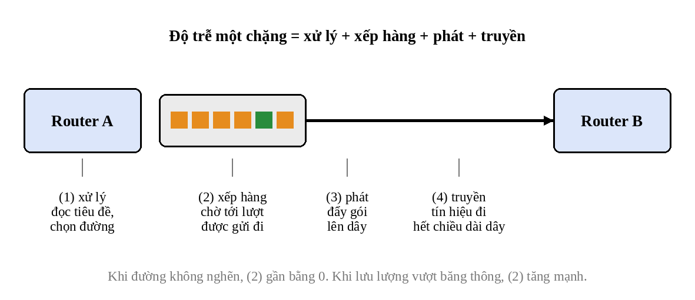
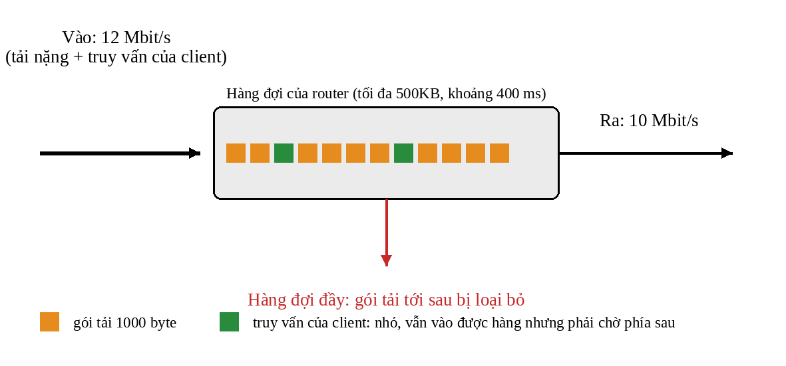

# CƠ SỞ LÝ THUYẾT

## Hiệu năng mạng máy tính

### Khái niệm hiệu năng mạng

Hiệu năng mạng là mức độ một hệ thống mạng đáp ứng được nhu cầu truyền dữ liệu của người dùng: dữ liệu có tới nơi đủ không, tới nhanh không, có đều đặn không. Hiệu năng không được đánh giá bằng một con số duy nhất mà bằng một nhóm thông số, mỗi thông số phản ánh một khía cạnh khác nhau [[REF:6]] [[REF:9]].

Mỗi loại ứng dụng nhạy cảm với một thông số khác nhau. Tải tệp cần thông lượng lớn nhưng chờ thêm vài trăm mili giây cũng không sao. Ngược lại, gọi thoại, họp trực tuyến hay trò chơi trực tuyến chỉ cần lưu lượng nhỏ nhưng rất nhạy với độ trễ. Đề tài tập trung vào nhóm ứng dụng thứ hai, nên **độ trễ** là thông số chính được đánh giá.

### Các yếu tố ảnh hưởng đến hiệu năng mạng

Hiệu năng của một kết nối phụ thuộc vào các yếu tố chính sau:

- **Băng thông của các đường truyền** trên đường đi, đặc biệt là đường truyền có băng thông nhỏ nhất.
- **Độ dài đường đi:** số đoạn đường truyền và số thiết bị trung gian mà gói phải đi qua.
- **Mức tải:** tổng lưu lượng của mọi người dùng cùng đi qua một đường truyền. Khi tải vượt băng thông, đường truyền bị tắc nghẽn.
- **Năng lực xử lý của thiết bị:** tốc độ router đọc tiêu đề gói, tra bảng định tuyến và chuyển tiếp.
- **Cách router chọn đường:** cùng một hạ tầng, nhưng lưu lượng dồn vào một đường hay được chia đều sẽ cho hiệu năng rất khác nhau.

Đề tài giữ nguyên băng thông, độ dài từng đường và thiết bị, chỉ thay đổi yếu tố cuối cùng là cách router chọn đường.

## Các thông số đánh giá hiệu năng mạng

### Băng thông và thông lượng

**Băng thông** (bandwidth) là lượng dữ liệu tối đa một đường truyền có thể chở trong một giây, tính bằng bit/giây. Trong đề tài, mỗi đoạn đường truyền giữa hai router có băng thông {{link_rate}} Mbit/s.

**Thông lượng** (throughput) là lượng dữ liệu thực tế truyền được trong một giây. Thông lượng không bao giờ vượt băng thông. Khi lưu lượng gửi vào lớn hơn băng thông, thông lượng chỉ đạt tới mức băng thông, phần dư bị giữ lại trong hàng đợi hoặc bị loại bỏ.

### Độ trễ

Độ trễ là thời gian một gói đi từ máy gửi tới máy nhận. Trên mỗi chặng, tức mỗi lần gói đi qua một router và một đoạn đường truyền, độ trễ gồm bốn thành phần [[REF:6]]:



- **Độ trễ xử lý:** thời gian router đọc tiêu đề gói và chọn cổng ra. Với router hiện đại, thời gian này rất nhỏ.
- **Độ trễ xếp hàng:** thời gian gói chờ trong hàng đợi tới lượt được gửi. Thành phần này bằng gần 0 khi đường truyền rảnh và tăng rất nhanh khi đường truyền quá tải.
- **Độ trễ phát:** thời gian đẩy toàn bộ các bit của gói lên đường truyền, bằng kích thước gói chia cho băng thông.
- **Độ trễ truyền:** thời gian tín hiệu đi hết chiều dài đường truyền, phụ thuộc khoảng cách. Đường càng dài, đi qua càng nhiều chặng thì tổng độ trễ truyền càng lớn.

Độ trễ của cả đường đi bằng tổng độ trễ của các chặng. **Thời gian khứ hồi RTT** là thời gian gói đi tới máy nhận cộng với thời gian trả lời quay về [[REF:1]]. RTT dễ đo hơn độ trễ một chiều vì chỉ cần đồng hồ của một máy, nên được đề tài dùng làm thước đo chính.

### Biến thiên độ trễ (Jitter)

Jitter phản ánh mức độ không đều của độ trễ giữa các gói liên tiếp. Với cùng một độ trễ trung bình, jitter lớn nghĩa là có gói tới sớm, có gói tới muộn, khiến âm thanh và hình ảnh bị ngắt quãng. RFC 3393 định nghĩa biến thiên độ trễ là hiệu độ trễ của các cặp gói [[REF:2]], còn RFC 3550 dùng một cách ước lượng jitter tương tự cho luồng thoại và video [[REF:8]].

Trong đề tài, jitter được tính tại client là trung bình độ lệch tuyệt đối giữa RTT của hai trả lời liên tiếp.

### Tỷ lệ mất gói

Tỷ lệ mất gói là phần trăm số gói gửi đi mà không tới được nơi nhận. Nguyên nhân phổ biến nhất là hàng đợi của router đã đầy nên gói mới tới bị loại bỏ. Với truy vấn của client, đề tài tính một truy vấn là mất nếu quá một giây chưa nhận được trả lời.

### Mối quan hệ giữa các thông số

Các thông số có liên hệ chặt chẽ với nhau. Khi lưu lượng gửi vào còn nhỏ hơn băng thông, thông lượng tăng theo lưu lượng, hàng đợi gần như trống, độ trễ chỉ gồm độ trễ truyền và xử lý. Khi lưu lượng vượt băng thông, thông lượng dừng ở mức băng thông, hàng đợi đầy dần nên độ trễ xếp hàng tăng vọt. Khi hàng đợi đầy hẳn, gói bị loại bỏ và tỷ lệ mất gói tăng. Vì vậy, tránh để đường truyền vượt băng thông là cách hiệu quả nhất để giữ độ trễ thấp.

## Tắc nghẽn và hàng đợi

### Khái niệm tắc nghẽn mạng

Tắc nghẽn xảy ra khi tổng lưu lượng muốn đi qua một đường truyền lớn hơn băng thông của đường truyền đó. Router không thể gửi nhanh hơn băng thông, nên phần lưu lượng dư phải chờ hoặc bị bỏ. Tắc nghẽn thường không do một người dùng gây ra riêng lẻ mà do nhiều luồng cùng dùng chung một đường truyền.

Điểm đáng chú ý là tắc nghẽn ảnh hưởng tới **mọi** người dùng đi chung đường truyền, kể cả người chỉ gửi rất ít dữ liệu. Trong đề tài, client chỉ gửi vài chục truy vấn nhỏ mỗi giây, nhưng vì đi chung đường với loadgen, truy vấn của client vẫn phải chờ trong cùng hàng đợi.

### Hàng đợi và độ trễ xếp hàng

Mỗi cổng ra của router có một hàng đợi. Hàng đợi đơn giản nhất hoạt động theo nguyên tắc vào trước ra trước (First In First Out – FIFO): gói nào tới trước được gửi trước, gói tới sau xếp phía sau.



Khi hàng đợi đầy, thời gian một gói mới phải chờ bằng dung lượng hàng đợi chia cho băng thông. Với hàng đợi {{queue_kb}}KB và băng thông {{link_rate}} Mbit/s, thời gian chờ là {{queue_kb}} × 1000 × 8 / ({{link_rate}} × 1.000.000) giây, tức khoảng {{queue_delay_ms}} mili giây. Con số này lớn hơn rất nhiều so với độ trễ truyền {{link_delay}} mili giây của mỗi đoạn đường truyền.

Hàng đợi trong đề tài giới hạn theo **số byte** chứ không theo số gói. Khi hàng đầy, gói tải lớn tới sau bị bỏ, nhưng truy vấn rất nhỏ của client vẫn có thể chen vào phần còn trống. Vì vậy client thường không mất gói mà chỉ phải chờ lâu.

## Các phương pháp giảm độ trễ

Từ các thành phần của độ trễ, có thể giảm độ trễ theo các hướng sau.

### Tối ưu đường đi và dùng tuyến ngắn hơn

Nếu giữa hai điểm có nhiều đường đi, chọn đường ngắn hơn sẽ giảm tổng độ trễ truyền. Trong định tuyến, đường được chọn thường là đường có chi phí nhỏ nhất, trong đó chi phí có thể tính theo số chặng, theo băng thông hoặc theo độ trễ của từng đường truyền [[REF:9]].

Tuy nhiên, đường ngắn chỉ có lợi khi nó không bị tắc nghẽn. Nếu mọi lưu lượng cùng dồn vào đường ngắn và vượt băng thông, độ trễ xếp hàng sẽ lớn hơn rất nhiều phần độ trễ truyền tiết kiệm được.

### Giảm số thiết bị trung gian

Mỗi thiết bị trung gian thêm vào một lần xử lý, một hàng đợi và một đoạn đường truyền. Đường đi qua ít router hơn thì có ít chỗ phải chờ hơn và ít điểm có thể bị quá tải hơn. Trong mô hình của đề tài, đường ngắn R1 → R3 bỏ qua router trung gian R2.

### Sử dụng thiết bị có khả năng xử lý nhanh hơn

Thay router bằng thiết bị mạnh hơn giảm được độ trễ xử lý, và thiết bị có băng thông lớn hơn giảm được độ trễ phát. Hướng này cần thay đổi phần cứng và chi phí đầu tư, nên không thuộc phạm vi đề tài.

### Phân phối tải

Thay vì để một đường truyền quá tải trong khi đường khác bỏ trống, router chia lưu lượng ra nhiều đường. Khi mỗi đường chỉ phải chở một phần lưu lượng và không đường nào vượt băng thông, hàng đợi không bị dồn ứ và độ trễ xếp hàng gần như bằng 0. Đây là cách tác động trực tiếp vào thành phần lớn nhất của độ trễ khi mạng có tải.

Đề tài thực hiện hai hướng chọn đường: dùng tuyến ngắn hơn với ít thiết bị trung gian, và phân phối tải ra hai đường.

## Định tuyến và chia tải nhiều đường

### Định tuyến tĩnh

Router quyết định chuyển gói tới đâu dựa vào **bảng định tuyến**: mỗi dòng cho biết muốn tới một mạng đích thì gửi gói qua router kế tiếp (next hop) nào. Với định tuyến tĩnh, các dòng này do người quản trị khai báo. Trên Linux, bảng định tuyến được quản lý bằng lệnh `ip route` [[REF:14]]. Ví dụ, lệnh `ip route replace 10.0.3.0/24 via 10.0.12.2` khai báo rằng gói tới mạng 10.0.3.0/24 sẽ được gửi qua router có địa chỉ 10.0.12.2.

Đổi đường đi chỉ cần thay router kế tiếp trong dòng tương ứng. Router không cần khởi động lại và các kết nối đang có không bị ngắt.

### Định tuyến nhiều đường chi phí bằng nhau (ECMP)

Khi có nhiều đường tới cùng một đích với chi phí bằng nhau, router có thể dùng tất cả các đường thay vì chỉ một. Kỹ thuật này gọi là ECMP [[REF:4]] [[REF:10]]. Trên Linux, một dòng định tuyến có thể có nhiều router kế tiếp, mỗi router kế tiếp kèm một trọng số:

```
ip route replace 10.0.3.0/24 nexthop via 10.0.12.2 weight 1 nexthop via 10.0.13.3 weight 1
```

Nếu router chia từng gói luân phiên ra các đường, các gói của cùng một kết nối có thể tới nơi không đúng thứ tự vì mỗi đường có độ trễ khác nhau. Để tránh điều này, router chia theo **luồng**: các gói có cùng địa chỉ IP nguồn, IP đích, cổng nguồn, cổng đích và giao thức được xem là một luồng. Router tính hàm băm trên các giá trị này rồi dùng kết quả để chọn đường [[REF:4]]. Mọi gói của cùng một luồng luôn đi cùng một đường.


Trên Linux, việc tính hàm băm có dùng cả cổng nguồn và cổng đích hay không được điều khiển bằng tham số `net.ipv4.fib_multipath_hash_policy`; giá trị 1 nghĩa là dùng cả cổng [[REF:13]]. Hàm băm chỉ chia đều khi có nhiều luồng. Nếu chỉ có vài luồng lớn, các luồng có thể dồn về cùng một đường. Vì lý do này, máy tạo tải của đề tài gửi lưu lượng thành nhiều luồng nhỏ, giống tình huống thực tế khi nhiều người dùng cùng dùng mạng.

## Môi trường và công cụ thực nghiệm

### EVE-NG và máy ảo Linux

EVE-NG (Emulated Virtual Environment – Next Generation) là nền tảng giả lập mạng chạy dưới dạng máy ảo, cho phép tạo nhiều máy ảo con và nối dây giữa chúng qua giao diện web hoặc giao diện lập trình REST [[REF:12]]. Mỗi node trong đề tài là một máy ảo Alpine Linux nhỏ gọn, được tạo bằng công cụ `alpine-make-vm-image` [[REF:11]]. Một máy Linux trở thành router khi bật tham số `net.ipv4.ip_forward=1`.

### Công cụ tc: giả lập độ trễ và băng thông

Công cụ `tc` (traffic control) của Linux gắn các bộ xếp hàng (queueing discipline – qdisc) vào cổng ra của card mạng [[REF:14]]. Đề tài dùng hai bộ:

- **netem:** thêm độ trễ cố định cho mọi gói đi ra, dùng để giả lập độ trễ truyền của đường truyền dài [[REF:3]].
- **tbf** (Token Bucket Filter): giới hạn tốc độ gửi ra ở một mức băng thông, gói vượt mức phải chờ trong hàng đợi có dung lượng giới hạn.

Kết hợp hai bộ này, mỗi đoạn đường truyền giữa hai router có độ trễ truyền {{link_delay}} mili giây và băng thông {{link_rate}} Mbit/s.

### Lập trình socket UDP trong C

Các chương trình đo đạc của đề tài được viết bằng C, dùng socket UDP [[REF:7]] của hệ điều hành Linux. Vị trí của từng phần trong mô hình TCP/IP được thể hiện ở hình dưới.


UDP được chọn vì không có cơ chế tự điều chỉnh tốc độ như TCP, nên tốc độ gửi của máy tạo tải đúng bằng giá trị cấu hình và các lượt thử nghiệm có điều kiện giống nhau. Truy vấn của client cũng dùng UDP để mỗi truy vấn là một gói độc lập, RTT đo được không bị ảnh hưởng bởi việc gửi lại gói của TCP.
