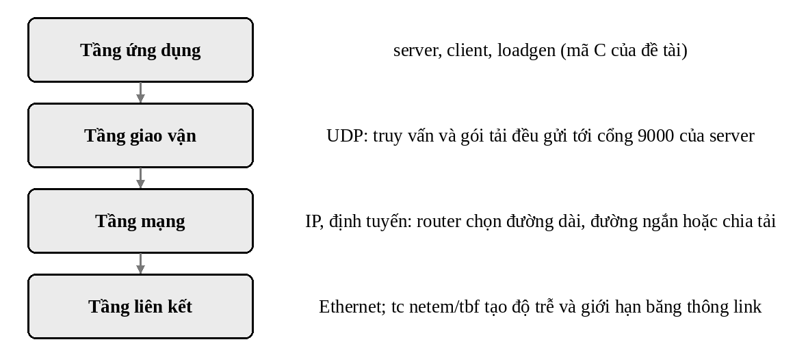
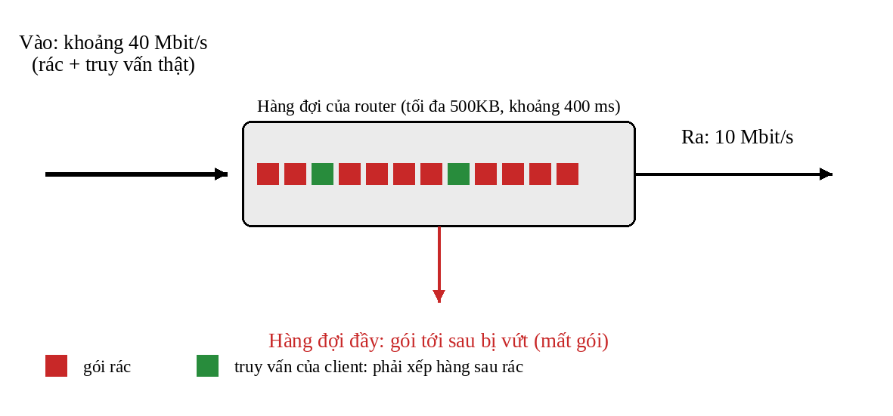
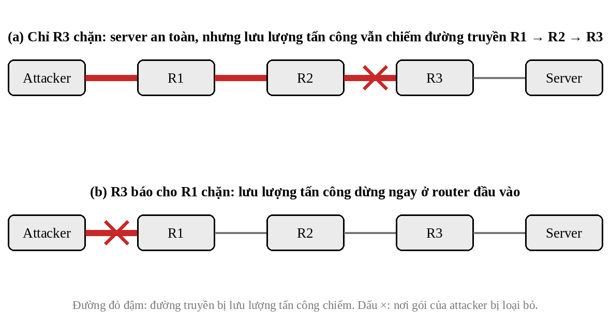
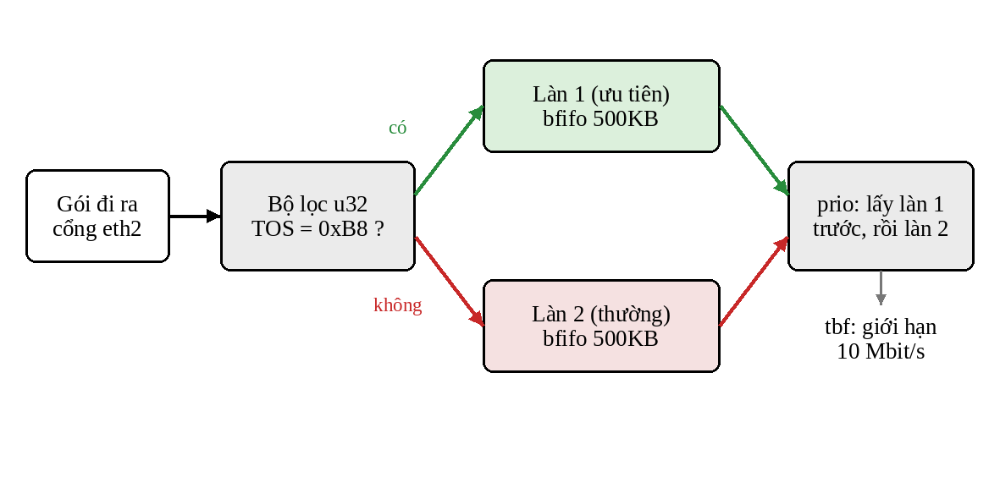

# CƠ SỞ LÝ THUYẾT

Chương này chỉ trình bày những kiến thức mà hệ thống thực sự dùng tới. Mỗi mục kết thúc bằng phần liên hệ với cách đề tài áp dụng, để người đọc thấy vì sao khái niệm đó cần thiết.

## Truyền thông mạng và giao thức UDP

### Mô hình TCP/IP

Mô hình TCP/IP chia việc truyền dữ liệu thành bốn tầng, mỗi tầng chỉ làm việc với tầng ngay trên và ngay dưới nó [[REF:5]]. Tầng ứng dụng là nơi các chương trình trao đổi dữ liệu có ý nghĩa với nhau. Tầng giao vận phân biệt các chương trình trên cùng một máy bằng số cổng. Tầng mạng đưa gói từ máy nguồn tới máy đích qua nhiều router dựa trên địa chỉ IP. Tầng liên kết lo việc chuyển khung dữ liệu trên từng đoạn dây cụ thể.

Biết một thành phần nằm ở tầng nào cho biết nó "nhìn thấy" gì. Server và client chỉ thấy nội dung truy vấn. iptables làm việc ở tầng mạng nên chặn được theo địa chỉ IP. Còn guard cần đếm cả những gói không gửi cho chính nó, nên phải đọc gói từ tầng liên kết.

### Giao thức UDP và lập trình socket

UDP (User Datagram Protocol) là giao thức tầng giao vận đơn giản nhất: mỗi gói được gửi đi độc lập, không bắt tay trước, không xác nhận, không gửi lại khi mất [[REF:9]]. Tiêu đề UDP chỉ có bốn trường: cổng nguồn, cổng đích, độ dài và mã kiểm tra. Vì không phải chờ phản hồi, một máy có thể bắn ra hàng nghìn gói UDP mỗi giây với rất ít tài nguyên. Đây vừa là ưu điểm cho các dịch vụ cần nhanh như DNS hay game, vừa là lý do UDP hay bị dùng để tấn công làm nghẽn.

Trên Linux, chương trình C làm việc với mạng thông qua socket. Với UDP, trình tự thường gặp là: `socket()` tạo socket kiểu `SOCK_DGRAM`, `bind()` gắn socket vào một cổng để nhận dữ liệu, `sendto()` và `recvfrom()` gửi, nhận từng gói kèm địa chỉ bên kia. Phía chỉ nói chuyện với một địa chỉ cố định có thể gọi `connect()` một lần rồi dùng `send()` và `recv()` cho gọn. Khi một chương trình phải theo dõi nhiều socket cùng lúc, hàm `poll()` cho phép chờ trên tất cả, socket nào có dữ liệu thì xử lý socket đó. Các chương trình của đề tài chỉ dùng những hàm hệ thống này, không dùng thêm thư viện mạng nào khác.

## Hiệu năng mạng

### Các đại lượng đo hiệu năng

**Băng thông** là lượng dữ liệu tối đa một đường truyền chuyển được trong một giây, ví dụ {{bottleneck}} Mbit/s. **Thông lượng** là lượng dữ liệu thực tế đang chạy qua đường truyền, luôn nhỏ hơn hoặc bằng băng thông. **Thời gian khứ hồi (RTT)** là khoảng thời gian từ lúc gửi một truy vấn tới lúc nhận được trả lời. **Tỉ lệ mất gói** là phần trăm gói đã gửi nhưng không bao giờ có trả lời.

Đối với người dùng, RTT là đại lượng dễ cảm nhận nhất: một trang web hay một cuộc gọi trở nên chậm chạp khi RTT tăng, dù đường truyền vẫn "thông". Vì vậy đề tài lấy RTT của client làm thước đo chính cho trải nghiệm của người dùng thật, và lấy thông lượng trên đoạn R1 → R2 làm thước đo cho mức độ lãng phí tài nguyên mạng.

### Hàng đợi, nút cổ chai và token bucket

Khi gói tới router nhanh hơn tốc độ đường ra, router không thể gửi ngay mà phải cho gói xếp hàng. Đường truyền chậm nhất trên một tuyến được gọi là **nút cổ chai**, vì nó quyết định tốc độ của cả tuyến. Hàng đợi càng dài, mỗi gói càng phải chờ lâu, RTT càng tăng. Khi hàng đợi đầy, gói tới sau bị vứt bỏ và trở thành gói mất.

Một điểm ít được để ý là hàng đợi thường được giới hạn theo **số byte** chứ không theo số gói. Khi hàng đợi gần đầy, một gói rác {{attack_size}} byte không còn chỗ và bị vứt, nhưng một gói truy vấn vài chục byte vẫn có thể chen vào. Kết quả là người dùng thật ít bị mất gói nhưng bị trễ rất nhiều, và số liệu ở Chương 4 cho thấy đúng hiện tượng đó.

Trên Linux, công cụ `tc` cho phép gắn bộ lập lịch hàng đợi vào một cổng mạng. Bộ lập lịch `tbf` (token bucket filter) mô phỏng một cái thùng chứa thẻ: thẻ được bơm vào đều đặn theo tốc độ cấu hình, mỗi byte gửi đi tiêu một thẻ, hết thẻ thì gói phải chờ [[REF:12]]. Nhờ vậy `tbf` biến một đường truyền ảo rất nhanh thành một đường truyền có băng thông cố định. Đề tài dùng `tbf` để tạo nút cổ chai {{bottleneck}} Mbit/s, vì nếu không giới hạn, đường truyền ảo giữa các máy ảo nhanh tới mức không bao giờ nghẽn và không thể thấy được tác hại của tấn công.

## Tấn công từ chối dịch vụ

### DoS, DDoS và UDP flood

Tấn công từ chối dịch vụ nhắm vào tính sẵn sàng của hệ thống: dữ liệu không bị đánh cắp, nhưng người dùng hợp lệ không truy cập được [[REF:3]]. Cách đơn giản nhất là làm cạn một loại tài nguyên nào đó, có thể là CPU của máy chủ, bộ nhớ, hoặc băng thông đường truyền. Khi lưu lượng tấn công xuất phát từ nhiều máy, thường là các máy bị chiếm quyền trong một botnet, ta có tấn công DDoS. Lúc đó không còn một địa chỉ nguồn rõ ràng nào để chặn [[REF:7]].

UDP flood là kiểu làm cạn băng thông: kẻ tấn công gửi liên tục các gói UDP cỡ lớn tới một cổng của nạn nhân. Vì UDP không cần bắt tay, mỗi gói đều đi thẳng tới đích và chiếm chỗ trên mọi đường truyền nó đi qua. Trong đề tài, attacker gửi {{attack_rate}} gói/giây, mỗi gói {{attack_size}} byte, tức khoảng bốn lần băng thông của nút cổ chai. Mỗi gói vẫn mang phần đầu đúng định dạng truy vấn, nên nếu chỉ nhìn một gói riêng lẻ thì không phân biệt được với truy vấn thật.

### Phát hiện dựa trên ngưỡng tần suất

Khi không phân biệt được bằng nội dung, có thể phân biệt bằng **hành vi**. Phương pháp đơn giản nhất là đếm số gói mỗi địa chỉ nguồn gửi trong một khoảng thời gian cố định, rồi so với một ngưỡng. Địa chỉ nào vượt ngưỡng thì bị xem là đang tấn công. Đây cũng chính là nguyên lý của cơ chế giới hạn tần suất (rate limiting) thường gặp ở các API.

Chọn ngưỡng là bài toán cân bằng. Ngưỡng quá thấp sẽ **báo nhầm** (false positive): chặn cả người dùng thật đang dùng nhiều. Ngưỡng quá cao sẽ **bỏ sót** (false negative): kẻ tấn công chỉ cần gửi chậm hơn ngưỡng một chút. Đề tài chọn ngưỡng {{threshold}} gói/giây, cách xa cả mức của client ({{client_rate}} gói/giây) lẫn mức của attacker. Ngoài ra còn dùng danh sách trắng (whitelist) gồm địa chỉ của client và server để chắc chắn không chặn nhầm hai máy này.

## Lọc gói trên Linux

### Netfilter và iptables

Netfilter là khung xử lý gói nằm trong nhân Linux. Nó cung cấp các điểm móc trên đường đi của gói, tại đó có thể kiểm tra, sửa hoặc bỏ gói. iptables là công cụ dòng lệnh để khai báo luật cho Netfilter [[REF:12]]. Luật được gom thành các chuỗi (chain). Chain `INPUT` áp dụng cho gói gửi tới chính máy đó, `OUTPUT` cho gói máy đó gửi ra, còn `FORWARD` cho gói **đi xuyên qua** máy. Router chuyển tiếp gói của người khác, nên chặn trên router phải đặt ở chain `FORWARD`.

Ngoài các chain có sẵn, người dùng có thể tạo chain riêng rồi cho chain có sẵn nhảy sang. Đề tài tạo một chain tên `GUARD`, gắn vào `FORWARD`, và chỉ thêm luật vào chain này. Một luật chặn có dạng `iptables -A GUARD -s 10.0.1.10 -j DROP`, nghĩa là bỏ mọi gói có địa chỉ nguồn 10.0.1.10. Cách tách chain riêng giúp dọn dẹp dễ dàng: khi chương trình dừng, chỉ cần gỡ và xóa chain `GUARD` là mạng trở về như cũ mà không đụng tới luật khác trên máy.

### Raw socket AF_PACKET

Socket UDP thông thường chỉ nhận được những gói gửi tới đúng cổng của nó. Để đếm **mọi** gói đi ngang qua một cổng mạng của router, kể cả gói không dành cho router, cần một loại socket đặc biệt. Trên Linux, socket họ `AF_PACKET` nhận bản sao của các khung dữ liệu ngay ở tầng liên kết, trước khi chúng đi lên các tầng trên [[REF:12]]. Với kiểu `SOCK_DGRAM`, phần tiêu đề Ethernet được bỏ sẵn, chương trình nhận về gói IP và tự đọc các trường cần thiết như địa chỉ nguồn, giao thức, cổng đích.

Hai đặc điểm của `AF_PACKET` ảnh hưởng trực tiếp tới thiết kế. Thứ nhất, nó cần quyền root. Thứ hai, nó thấy gói **trước** khi Netfilter xử lý, nên kể cả sau khi đã chặn, guard vẫn tiếp tục đếm được gói của kẻ tấn công. Chương trình vì thế phải tự nhớ những địa chỉ đã chặn để không chặn lặp lại.

## Phòng thủ cộng tác

### Chặn gần nạn nhân và chặn ở đầu nguồn

Có hai vị trí để chặn lưu lượng tấn công. Chặn **gần nạn nhân** có lợi thế là thấy rõ: mọi lưu lượng tới máy chủ đều đi qua đây, nên dễ nhận ra địa chỉ nào đang dồn truy vấn. Nhưng tới lúc bị chặn, gói rác đã đi hết quãng đường và đã chiếm băng thông của mọi đoạn phía trước. Chặn **ở đầu nguồn**, tức ở router cửa vào gần kẻ tấn công, thì ngược lại: tiết kiệm tài nguyên cho toàn bộ mạng phía sau, nhưng router cửa vào thấy lưu lượng đi tới rất nhiều đích khác nhau và không biết đích nào đang bị quá tải.

Phòng thủ cộng tác kết hợp ưu điểm của cả hai: node gần nạn nhân làm việc phát hiện, sau đó gửi thông tin cho node ở đầu nguồn làm việc chặn. Thông tin cần truyền rất ít, trong đề tài chỉ là một dòng chữ cho biết địa chỉ cần chặn và ai gửi.

### RTBH và BGP FlowSpec

Ý tưởng trên đã được dùng thật ở quy mô Internet. Với RTBH, nhà mạng gắn một nhãn đặc biệt vào thông tin định tuyến của địa chỉ đang bị tấn công. Các router biên nhận được thông tin đó sẽ bỏ toàn bộ lưu lượng tới địa chỉ này ngay tại biên [[REF:4]]. Cách này cứu được phần còn lại của mạng nhưng hy sinh luôn nạn nhân. BGP FlowSpec tinh tế hơn: các router trao đổi những luật lọc mô tả chính xác luồng xấu, ví dụ theo địa chỉ nguồn, giao thức và cổng, rồi mỗi router tự cài luật đó [[REF:6]]. Thông điệp `BLOCK <địa chỉ>` trong đề tài có thể xem là một phiên bản rất thu nhỏ của luật FlowSpec.

### Kênh truyền cảnh báo

Cảnh báo phải tới được nơi cần chặn đúng lúc mạng đang bị tấn công. Có hai cách truyền. **Ngoài băng (out-of-band)** dùng một mạng quản lý riêng, tách hẳn khỏi đường dữ liệu, nên không bị ảnh hưởng bởi tình trạng nghẽn. Các nhà mạng thường có mạng quản lý như vậy để điều khiển thiết bị. **Trong băng (in-band)** cho cảnh báo đi chung đường với dữ liệu. Cách này không cần thêm hạ tầng, nhưng phải có cơ chế để cảnh báo không bị kẹt sau đống rác. Đề tài thử nghiệm cả hai cách, và cơ chế dùng cho cách thứ hai là QoS.

## Chất lượng dịch vụ (QoS)

### Trường DSCP và lớp chuyển tiếp ưu tiên EF

QoS là tập hợp các kỹ thuật cho phép mạng đối xử khác nhau với các loại lưu lượng khác nhau. Trong mô hình phân biệt dịch vụ (DiffServ), mỗi gói IP mang một giá trị 6 bit gọi là DSCP, nằm trong byte thứ hai của tiêu đề IPv4, vốn trước đây là byte TOS [[REF:8]]. Router đọc giá trị này để quyết định gói thuộc lớp nào. Lớp chuyển tiếp ưu tiên EF (Expedited Forwarding) có DSCP bằng 46, dành cho lưu lượng cần độ trễ thấp như thoại [[REF:1]]. Vì DSCP chiếm 6 bit cao của byte TOS, giá trị byte TOS tương ứng là 46 × 4 = 184, tức `0xB8`.

Trong chương trình C, một ứng dụng đánh dấu gói của mình bằng cách đặt tùy chọn `IP_TOS` cho socket. Mọi gói gửi qua socket đó sẽ mang byte TOS đã đặt.

### Hàng đợi ưu tiên và ranh giới tin cậy

Đánh dấu chỉ có ích khi router làm gì đó với dấu. Bộ lập lịch `prio` của Linux chia hàng đợi thành nhiều làn và luôn lấy gói từ làn có ưu tiên cao trước, làn thấp chỉ được phục vụ khi làn cao trống [[REF:12]]. Kết hợp với một bộ lọc đọc trường DSCP, gói mang dấu EF sẽ vào làn ưu tiên và vượt qua cả một hàng dài gói rác đang chờ.

Điểm yếu là dấu do chính người gửi đặt. Nếu router tin mọi dấu, kẻ tấn công chỉ cần đánh dấu gói rác là EF để chen vào làn ưu tiên. Vì vậy mạng thực tế luôn có **ranh giới tin cậy (trust boundary)**: router ở cửa vào xóa hoặc ghi lại dấu trên mọi gói đến từ bên ngoài, chỉ giữ dấu cho lưu lượng do chính hệ thống sinh ra. Đề tài chưa cài đặt ranh giới này, và đây là một trong các hạn chế được nêu ở Chương 5.

## Môi trường giả lập

### KVM, QEMU và ảo hóa lồng nhau

KVM (Kernel-based Virtual Machine) là thành phần của nhân Linux dùng tính năng ảo hóa phần cứng của CPU để chạy máy ảo với tốc độ gần bằng máy thật, còn QEMU giả lập phần cứng như ổ đĩa và card mạng. Trong đề tài, EVE-NG là một máy ảo trên laptop, và bên trong nó lại chạy sáu máy ảo nhỏ cho sáu node. Cách chạy máy ảo trong máy ảo này gọi là **ảo hóa lồng nhau** (nested virtualization), chỉ dùng được khi CPU hỗ trợ và tính năng đã được bật.

### EVE-NG

EVE-NG là nền tảng giả lập mạng: người dùng tạo lab trên giao diện web, kéo thả các node, nối dây giữa chúng, rồi bật lab để các node chạy thật [[REF:11]]. Mỗi node là một máy ảo chạy từ một ổ đĩa mẫu (image). Các đường nối là các cầu mạng ảo bên trong máy EVE-NG. Bản Community miễn phí đủ cho nhu cầu của đề tài. Ngoài giao diện web, EVE-NG có REST API, đề tài dùng API này để tạo lab bằng script thay vì thao tác tay. Node dùng Alpine Linux, một bản Linux rất nhẹ, được đóng gói thành image bằng công cụ `alpine-make-vm-image` [[REF:10]].

### Network namespace

Network namespace cho phép một nhóm tiến trình có bộ cổng mạng, bảng định tuyến và luật iptables riêng như một máy độc lập. Nối các namespace bằng cặp cổng ảo `veth` là dựng được cả mạng nhiều node trên một máy. Đề tài dùng cách này làm bản thu nhỏ của lab EVE-NG để kiểm thử nhanh và làm phương án dự phòng khi trình diễn.
