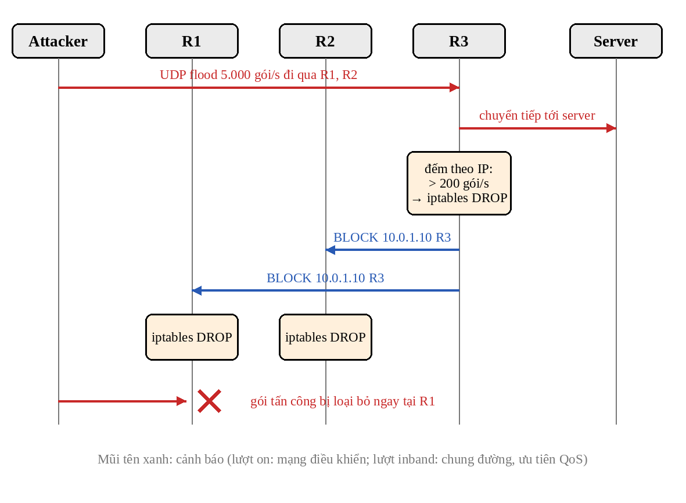

# PHÂN TÍCH

## Phân tích bài toán

### Kịch bản tấn công và ảnh hưởng tới người dùng

Xét tình huống: client đang dùng dịch vụ bình thường, mỗi giây gửi {{client_rate}} truy vấn tới server và nhận trả lời gần như tức thì. Tới một thời điểm, attacker bắt đầu gửi {{attack_rate}} gói mỗi giây, mỗi gói {{attack_size}} byte, cùng tới server. Lưu lượng này gấp khoảng bốn lần băng thông {{bottleneck}} Mbit/s của hai đoạn R1–R2 và R2–R3.

Chuyện gì xảy ra lúc đó? Hàng đợi ở cổng ra của R1 đầy lên rất nhanh. Phần lớn gói rác bị vứt ngay tại đây, nhưng phần lọt qua vẫn đủ lấp đầy đường truyền. Truy vấn của client đi chung đường nên phải xếp hàng sau đống rác. Từ góc nhìn của người dùng, dịch vụ không "sập" mà trở nên cực kỳ chậm. Đây chính là thứ cần cải thiện, và cũng là lý do đề tài lấy RTT của client làm thước đo chính, thay vì chỉ đo xem server còn sống hay không.

### Vị trí phát hiện và vị trí chặn

Bài toán có một mâu thuẫn. Router nào cũng có thể chạy iptables để chặn, nhưng không phải router nào cũng biết **chặn ai**. Như đã nêu ở mục 1.1, R3 là điểm giám sát lưu lượng đi tới server. Trong khi đó, R1 ở cửa vào nhìn thấy lưu lượng đi tới nhiều đích khác nhau. Trong mạng thật, R1 còn có thể thuộc về một tổ chức khác, chẳng hạn nhà mạng, và không biết máy chủ phía sau chịu được bao nhiêu tải. Với một cuộc tấn công phân tán, mỗi nguồn đi qua R1 có khi chỉ gửi rất ít, chỉ khi dồn lại ở gần nạn nhân mới thấy bất thường [[REF:7]].

Ngược lại, vị trí chặn hiệu quả nhất lại là R1, vì chặn ở đó thì gói rác không bao giờ chạm tới hai đoạn nút cổ chai. Kết luận rút ra là: **nơi phát hiện tốt nhất và nơi chặn tốt nhất không trùng nhau**, nên cần một cơ chế đưa thông tin từ R3 về R1. Đây chính là phần "cộng tác" của đề tài.

## Các phương án xử lý

Từ phân tích trên, đề tài xây dựng và so sánh ba phương án, ứng với ba lượt demo.

Bảng: So sánh ba phương án xử lý
| Tiêu chí | off: chỉ R3 chặn | on: hợp tác qua mạng riêng | inband: hợp tác chung đường + QoS |
|---|---|---|---|
| Nơi phát hiện | R3 | R3 | R3 |
| Nơi chặn | R3 | R3, R1, R2 | R3, R1, R2 |
| Server được bảo vệ | Có | Có | Có |
| Link R1 → R3 được giải phóng | Không | Có | Có |
| Hạ tầng cần thêm | Không | Một mạng điều khiển nối các router | Hàng đợi ưu tiên trên các router |
| Rủi ro cảnh báo không tới | Không có cảnh báo | Thấp, kênh tách khỏi đường bị nghẽn | Phụ thuộc QoS hoạt động đúng |
| Mức độ giống thực tế | Cao, nhưng là cách làm bị động | Giống mạng quản lý của nhà mạng | Giống cách gửi lệnh chặn qua kết nối có sẵn |

Phương án **off** là mốc so sánh: nó cho thấy chặn đơn lẻ bảo vệ được server nhưng không bảo vệ được mạng.

Phương án **on** giải quyết bài toán theo cách chắc chắn nhất: cảnh báo đi trên mạng 10.0.99.0/24 nối riêng ba router, không chung đường với rác. Nhược điểm là phải có thêm một mạng. Ngoài đời, các router có thể cách nhau rất xa, nên mạng này thường là một đường quản lý riêng hoặc một kết nối VPN chứ không phải một switch.

Phương án **inband** bỏ mạng riêng: R3 gửi cảnh báo thẳng tới địa chỉ dữ liệu của R2 và R1. Để cảnh báo không bị kẹt sau rác khi đường nghẽn, gói cảnh báo được đánh dấu ưu tiên EF, và mọi đoạn giữa các router đều có hàng đợi hai làn.

## Yêu cầu phi chức năng

Yêu cầu chức năng của từng chương trình đã được nêu ở mục 1.4. Bên cạnh đó, hệ thống cần thỏa các yêu cầu sau:

- **Phản ứng nhanh:** thời gian phát hiện và thời gian lan truyền quyết định chặn phải đạt tiêu chí 1 và 2 ở Bảng 1.1.
- **Không chặn nhầm:** địa chỉ của client, server và các địa chỉ trong mạng điều khiển nằm trong danh sách không được chặn. Guard từ chối mọi yêu cầu chặn các địa chỉ này, kể cả khi yêu cầu đến từ cảnh báo của router khác.
- **An toàn khi gọi lệnh hệ thống:** guard gọi iptables bằng `fork` và `execvp` với từng tham số riêng, không ghép chuỗi lệnh để chạy qua shell. Nội dung cảnh báo nhận từ mạng được kiểm tra chặt trước khi dùng.
- **Dọn dẹp sạch:** khi guard dừng, toàn bộ luật đã thêm bị gỡ, mạng trở về trạng thái ban đầu để lượt thử nghiệm sau không bị ảnh hưởng.
- **Tái lập được:** dựng lab, chạy thử nghiệm, thu số liệu và vẽ biểu đồ đều bằng script.

## Luồng xử lý khi bị tấn công

Hình dưới mô tả trình tự các sự kiện ở lượt có hợp tác. Attacker gửi rác qua R1, R2 tới R3. Sau một giây đếm, R3 thấy địa chỉ 10.0.1.10 vượt ngưỡng. R3 thêm luật chặn cho chính mình, rồi gửi cảnh báo cho R2 và R1. Hai router này kiểm tra cảnh báo và thêm luật chặn. Từ đó, gói của attacker bị vứt ngay khi tới R1, phần còn lại của mạng không còn thấy gói rác nào.

Có hai điểm đáng chú ý trong luồng này. Thứ nhất, R3 chỉ phát hiện ở cuối mỗi chu kỳ đếm một giây, nên thời gian phát hiện luôn nằm trong khoảng một giây sau khi tấn công bắt đầu. Thứ hai, R1 và R2 không tự kiểm chứng gì thêm mà tin cảnh báo của R3. Điều này làm phản ứng rất nhanh nhưng cũng mở ra khả năng bị giả mạo cảnh báo, như sẽ bàn ở Chương 5.
