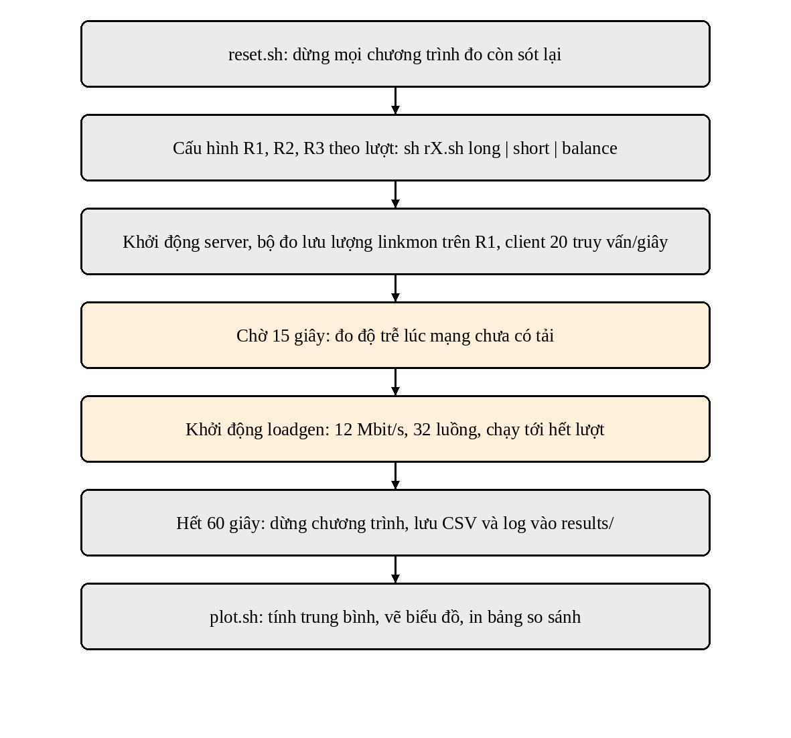

# PHÂN TÍCH

## Phân tích vấn đề giảm độ trễ

### Bối cảnh và vấn đề cần giải quyết

Trong một mạng nhiều người dùng, các luồng dữ liệu có nhu cầu rất khác nhau nhưng lại đi chung đường truyền. Một máy đang tải tệp lớn có thể gửi liên tục với tốc độ cao, còn người đang gọi thoại chỉ gửi những gói nhỏ nhưng cần chúng tới thật nhanh. Khi lưu lượng tải tệp vượt băng thông, hàng đợi trên router dồn đầy và gói của người gọi thoại cũng phải chờ theo, dù họ không phải là nguyên nhân.

Mặt khác, giữa hai điểm trong mạng thường có nhiều hơn một đường, chẳng hạn một đường chính và một đường dự phòng, hay hai tuyến cáp đi theo hai hướng. Nếu router chỉ dùng một đường thì có thể một đường quá tải trong khi đường kia để không, hoặc lưu lượng phải đi vòng xa hơn mức cần thiết.

Từ đó, bài toán đặt ra là: với hạ tầng sẵn có, router nên chọn đường thế nào để người dùng gặp độ trễ thấp nhất, cả lúc mạng rảnh lẫn lúc mạng đông.

### Giải pháp đề xuất

Đề tài đề xuất hai cách chọn đường, ứng với hai thành phần của độ trễ đã nêu ở Chương 2:

- Chọn đường ngắn hơn để giảm độ trễ truyền và số thiết bị trung gian. Cách này làm giảm phần độ trễ cố định, phần luôn có kể cả khi mạng không có tải.
- Phân phối tải ra nhiều đường để không đường nào vượt băng thông. Cách này làm giảm độ trễ xếp hàng, phần chiếm gần hết độ trễ khi mạng có tải.

Cả hai cách đều chỉ sửa bảng định tuyến của router, không thay thiết bị và không tăng băng thông. Để đánh giá, đề tài cho cùng một lưu lượng chạy qua mạng với ba cách chọn đường, trong đó cách mọi lưu lượng đi đường dài làm mốc để so sánh hai cách còn lại.

## Phân tích yêu cầu thực nghiệm

### Yêu cầu về môi trường mô phỏng

Môi trường thực nghiệm cần có:

- Có ít nhất hai đường đi khác nhau về độ dài giữa phía người dùng và phía server.
- Mỗi đường truyền có độ trễ truyền và băng thông xác định, giống nhau giữa các lần chạy.
- Router chạy hệ điều hành cho phép đổi bảng định tuyến và chia tải nhiều đường bằng lệnh.
- Các node điều khiển được từ xa bằng script để tự động hóa việc cấu hình và đo.

EVE-NG cùng các node Alpine Linux đáp ứng được những yêu cầu này. Độ trễ và băng thông đường truyền được giả lập bằng `tc`, nên điều kiện đường truyền ở mọi lượt chạy đều như nhau.

### Yêu cầu tạo và kiểm soát lưu lượng

Lưu lượng thử nghiệm phải đủ lớn để gây tắc nghẽn khi chỉ dùng một đường, nhưng không gây tắc nghẽn khi dùng cả hai đường. Với băng thông mỗi đường là {{link_rate}} Mbit/s, lưu lượng tải được chọn là {{load_mbit}} Mbit/s: lớn hơn một đường nhưng nhỏ hơn tổng hai đường ({{two_links_mbit}} Mbit/s).

Lưu lượng tải cần gồm nhiều luồng để router có thể chia ra hai đường, đề tài dùng {{load_flows}} luồng. Lưu lượng của client cần nhỏ, đều và có trả lời để đo được RTT, đề tài dùng {{client_rate}} truy vấn mỗi giây.

### Yêu cầu thu thập dữ liệu

Số liệu cần được ghi theo từng giây để thấy rõ trước và sau lúc có tải. Mỗi lượt cần có RTT, jitter, tỷ lệ mất gói của client, thông lượng server nhận được và lưu lượng R1 gửi ra trên từng đường. Thời gian trong các tệp số liệu tính từ lúc bắt đầu lượt, nên các lượt khác nhau vẽ được trên cùng một trục thời gian.

## Phân tích mô hình mạng thực nghiệm

### Các thành phần của mô hình mạng

Mô hình gồm sáu node với vai trò như sau:

Bảng: Vai trò các node trong mô hình
| Node | Vai trò | Chương trình chạy |
|---|---|---|
| Client | Người dùng cần phản hồi nhanh, đo độ trễ | `client` |
| Loadgen | Máy tạo tải lớn, gây tắc nghẽn | `loadgen` |
| R1 | Router đầu vào, chọn đường tới server | Bảng định tuyến, bộ đo lưu lượng `linkmon.sh` |
| R2 | Router trung gian của đường dài | Bảng định tuyến |
| R3 | Router phía server, chọn đường cho chiều về | Bảng định tuyến |
| Server | Trả lời truy vấn, đo thông lượng nhận được | `server` |

### Kết nối và đường đi của lưu lượng

Truy vấn của client và gói tải của loadgen đều đi theo chiều LAN1 → R1 → (đường dài hoặc đường ngắn) → R3 → server. Trả lời của server đi theo chiều ngược lại, lúc này R3 là router chọn đường. Gói tải không có trả lời nên chiều về chỉ có lưu lượng rất nhỏ của client.

Tắc nghẽn xảy ra ở cổng ra của R1 trên đường được chọn, vì tại đây toàn bộ lưu lượng {{load_mbit}} Mbit/s phải đi vào một đường truyền {{link_rate}} Mbit/s. Bộ đo lưu lượng vì thế được đặt ở R1 để thấy mỗi đường nhận bao nhiêu.

## Phân tích các kịch bản thử nghiệm

### Ba kịch bản chọn đường

Ba kịch bản dùng chung mô hình và lưu lượng, chỉ khác bảng định tuyến của R1 và R3.

Bảng: Ba kịch bản thử nghiệm
| Kịch bản | R1 gửi tới server qua | R3 gửi về client qua | Mục đích |
|---|---|---|---|
| base | R2 (đường dài) | R2 (đường dài) | Mốc so sánh, trạng thái trước khi tối ưu |
| short | R3 trực tiếp (đường ngắn) | R1 trực tiếp (đường ngắn) | Đánh giá tác dụng của đường ngắn, ít thiết bị trung gian |
| balance | Cả hai đường, chia theo luồng | Cả hai đường, chia theo luồng | Đánh giá tác dụng của phân phối tải |

Theo tính toán, khi chưa có tải, RTT của kịch bản base gồm bốn lần độ trễ truyền (đi hai đoạn, về hai đoạn), khoảng {{prop_long_ms}} mili giây, còn kịch bản short chỉ có hai lần, khoảng {{prop_short_ms}} mili giây. Ở kịch bản balance, chiều đi và chiều về của client có thể rơi vào hai đường khác nhau, nên RTT sẽ nằm giữa hai giá trị trên. Khi có tải, base và short đều dồn {{load_mbit}} Mbit/s vào một đường nên dự kiến RTT tăng thêm khoảng {{queue_delay_ms}} mili giây do xếp hàng, còn balance thì không.

### Điều kiện đảm bảo tính so sánh

Để so sánh được các kịch bản với nhau, mọi lượt thử nghiệm giữ nguyên các điều kiện sau:

- Mô hình, địa chỉ, độ trễ và băng thông của từng đường truyền.
- Thời gian một lượt ({{duration}} giây) và thời điểm bắt đầu tải (giây thứ {{load_at}}).
- Tốc độ, kích thước gói và số luồng của loadgen; tốc độ truy vấn của client.
- Cách tính trung bình: lúc chưa có tải lấy từ giây thứ 2 tới trước giây {{load_at}}, lúc có tải bỏ giây đầu tiên có tải và giây cuối cùng.

Trước mỗi lượt, các chương trình đo của lượt trước đều được dừng hẳn và router được cấu hình lại từ đầu.

### Trình tự thực nghiệm

Mỗi lượt do một script điều khiển và chạy theo trình tự trong hình dưới.

## Phân tích tiêu chí đánh giá

### Dữ liệu cần thu thập

Bảng: Dữ liệu thu thập trong mỗi lượt
| Dữ liệu | Nơi đo | Cách đo |
|---|---|---|
| RTT, jitter, tỷ lệ mất gói | Client | Ghi thời điểm gửi từng truy vấn, so với thời điểm nhận trả lời |
| Thông lượng nhận được | Server | Cộng số byte nhận được trong mỗi giây |
| Lưu lượng trên từng đường | R1 | Hiệu bộ đếm byte gửi ra của card mạng `eth2` và `eth3` sau mỗi giây |
| Bảng định tuyến đang dùng | R1 | Ghi lại kết quả lệnh `ip route` ở đầu lượt |

### Tiêu chí so sánh

Các kịch bản được so sánh theo những tiêu chí sau:

- **RTT lúc chưa có tải:** phản ánh độ dài đường đi.
- **RTT lúc có tải:** chỉ số chính, phản ánh độ trễ người dùng gặp khi mạng đông.
- **Phần RTT tăng thêm khi có tải:** bằng RTT lúc có tải trừ RTT lúc chưa có tải, phản ánh thời gian xếp hàng.
- **Jitter và tỷ lệ mất gói của client:** phản ánh độ ổn định.
- **Thông lượng server nhận được:** kiểm tra cách chọn đường có làm giảm khả năng truyền dữ liệu không.

Mức giảm độ trễ của từng kịch bản được tính theo phần trăm so với kịch bản base.
