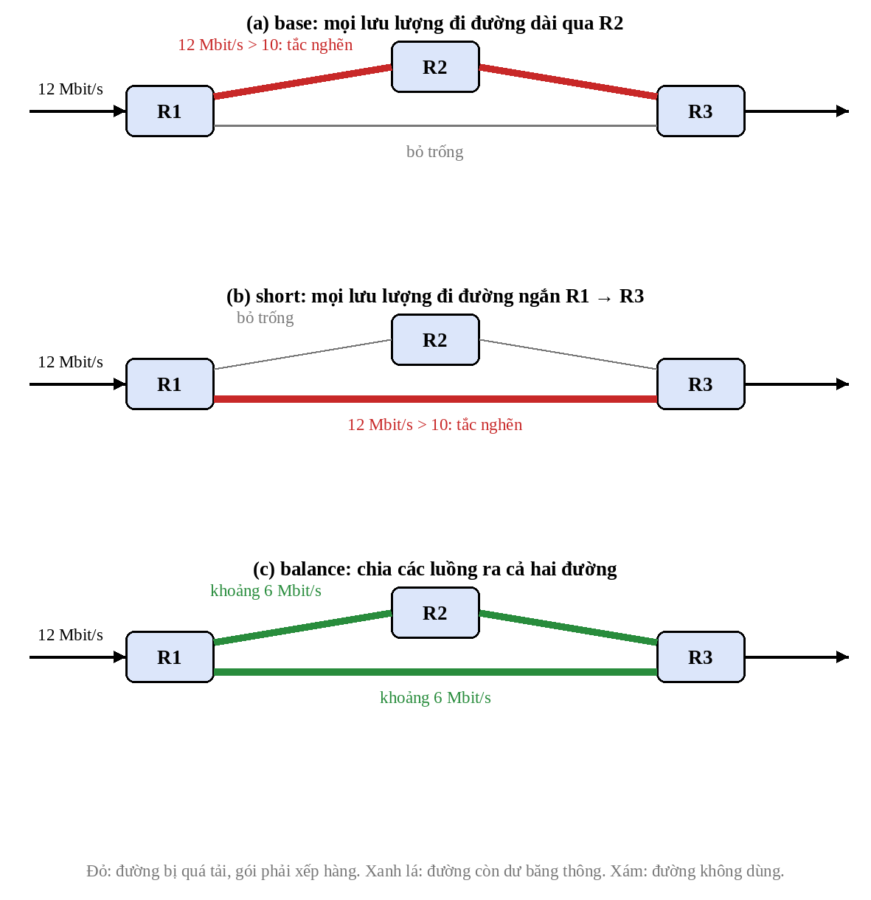

# PHÂN TÍCH

## Phân tích vấn đề giảm độ trễ

### Bối cảnh và vấn đề cần giải quyết

Trong một mạng có nhiều người dùng, các luồng dữ liệu có nhu cầu rất khác nhau đi chung đường truyền. Một máy đang tải tệp lớn có thể gửi liên tục với tốc độ cao, trong khi một người đang gọi thoại chỉ gửi những gói nhỏ nhưng cần chúng tới nơi thật nhanh. Khi lưu lượng của máy tải tệp vượt băng thông đường truyền, hàng đợi trên router dồn đầy và gói của người gọi thoại cũng phải chờ theo, dù họ không gây ra tình trạng đó.

Mặt khác, giữa hai điểm trong mạng thường có nhiều hơn một đường đi, ví dụ một đường chính và một đường dự phòng, hoặc hai tuyến cáp đi theo hai hướng khác nhau. Nếu router chỉ dùng một đường, có thể xảy ra tình trạng một đường quá tải trong khi đường kia bỏ trống, hoặc lưu lượng đi đường vòng xa hơn cần thiết.

Bài toán của đề tài là: **với hạ tầng có sẵn, router chọn đường thế nào để độ trễ của người dùng thấp nhất**, cả khi mạng thông thoáng lẫn khi mạng có tải.

### Giải pháp đề xuất

Đề tài đề xuất hai cách chọn đường, ứng với hai thành phần của độ trễ đã phân tích ở Chương 2:

- **Chọn đường ngắn hơn** để giảm độ trễ truyền và số thiết bị trung gian. Cách này tác động vào phần độ trễ cố định, có mặt cả khi mạng không có tải.
- **Phân phối tải ra nhiều đường** để không đường nào vượt băng thông. Cách này tác động vào độ trễ xếp hàng, thành phần chiếm phần lớn khi mạng có tải.

Cả hai cách đều chỉ thay đổi bảng định tuyến của router, không thay thiết bị và không tăng băng thông. Hiệu quả được đánh giá bằng cách đo cùng một kịch bản lưu lượng với ba cách chọn đường, rồi so sánh với trường hợp mọi lưu lượng đi đường dài.

## Phân tích yêu cầu thực nghiệm

### Yêu cầu về môi trường mô phỏng

Môi trường thực nghiệm cần đáp ứng:

- Có ít nhất hai đường đi khác nhau về độ dài giữa phía người dùng và phía server.
- Mỗi đường truyền có độ trễ truyền và băng thông xác định, giống nhau giữa các lần chạy.
- Router chạy hệ điều hành cho phép đổi bảng định tuyến và chia tải nhiều đường bằng lệnh.
- Các node điều khiển được từ xa bằng script để tự động hóa việc cấu hình và đo.

EVE-NG với các node Alpine Linux đáp ứng được các yêu cầu này. Độ trễ và băng thông đường truyền được giả lập bằng `tc` nên giống hệt nhau ở mọi lượt chạy.

### Yêu cầu tạo và kiểm soát lưu lượng

Lưu lượng thử nghiệm cần tạo được tình trạng tắc nghẽn khi chỉ dùng một đường, nhưng không tắc nghẽn khi dùng cả hai đường. Với băng thông mỗi đường là {{link_rate}} Mbit/s, lưu lượng tải được chọn là {{load_mbit}} Mbit/s: lớn hơn một đường nhưng nhỏ hơn tổng hai đường ({{two_links_mbit}} Mbit/s).

Lưu lượng tải phải gồm nhiều luồng để router có thể chia ra hai đường; đề tài dùng {{load_flows}} luồng. Lưu lượng của client cần nhỏ, đều đặn và có trả lời để đo được RTT; đề tài dùng {{client_rate}} truy vấn mỗi giây.

### Yêu cầu thu thập dữ liệu

Số liệu cần được ghi theo từng giây để thấy rõ thời điểm trước và sau khi có tải. Mỗi lượt cần thu được RTT, jitter và tỷ lệ mất gói của client, thông lượng server nhận được, và lưu lượng R1 gửi ra trên từng đường. Thời gian trong các tệp số liệu được tính từ lúc bắt đầu lượt, nên số liệu của các lượt khác nhau so sánh được trên cùng một trục thời gian.

## Phân tích mô hình mạng thực nghiệm

### Các thành phần của mô hình mạng

Mô hình gồm sáu node với vai trò như sau:

Bảng: Vai trò các node trong mô hình
| Node | Vai trò | Chương trình chạy |
|---|---|---|
| Client | Người dùng cần phản hồi nhanh, đo độ trễ | `client` |
| Loadgen | Máy tạo tải lớn, gây tắc nghẽn | `loadgen` |
| R1 | Router đầu vào, chọn đường tới server | Bảng định tuyến, bộ đo lưu lượng `linkmon.sh` |
| R2 | Router trung gian của đường dài | Bảng định tuyến |
| R3 | Router phía server, chọn đường cho chiều về | Bảng định tuyến |
| Server | Trả lời truy vấn, đo thông lượng nhận được | `server` |

### Kết nối và đường đi của lưu lượng

Truy vấn của client và gói tải của loadgen đều đi theo chiều LAN1 → R1 → (đường dài hoặc đường ngắn) → R3 → server. Trả lời của server đi theo chiều ngược lại, do R3 chọn đường. Gói tải không có trả lời nên chiều về chỉ có lưu lượng rất nhỏ của client.

Vị trí xảy ra tắc nghẽn là **cổng ra của R1** trên đường được chọn, vì đây là nơi toàn bộ lưu lượng {{load_mbit}} Mbit/s đi vào một đường truyền {{link_rate}} Mbit/s. Bộ đo lưu lượng được đặt tại R1 để thấy rõ mỗi đường nhận bao nhiêu lưu lượng.

## Phân tích các kịch bản thử nghiệm

### Ba kịch bản chọn đường

Ba kịch bản dùng cùng mô hình, cùng lưu lượng, chỉ khác bảng định tuyến của R1 và R3:

Bảng: Ba kịch bản thử nghiệm
| Kịch bản | R1 gửi tới server qua | R3 gửi về client qua | Mục đích |
|---|---|---|---|
| base | R2 (đường dài) | R2 (đường dài) | Mốc so sánh, trạng thái trước khi tối ưu |
| short | R3 trực tiếp (đường ngắn) | R1 trực tiếp (đường ngắn) | Đánh giá tác dụng của đường ngắn, ít thiết bị trung gian |
| balance | Cả hai đường, chia theo luồng | Cả hai đường, chia theo luồng | Đánh giá tác dụng của phân phối tải |

Theo lý thuyết, khi chưa có tải, RTT của kịch bản base gồm bốn lần độ trễ truyền (đi qua hai đoạn, về qua hai đoạn), tức khoảng {{prop_long_ms}} mili giây, còn kịch bản short chỉ có hai lần, khoảng {{prop_short_ms}} mili giây. Ở kịch bản balance, chiều đi và chiều về của client có thể được chia vào hai đường khác nhau, nên RTT nằm trong khoảng giữa hai giá trị trên. Khi có tải, kịch bản base và short đều dồn {{load_mbit}} Mbit/s vào một đường nên dự kiến có thêm khoảng {{queue_delay_ms}} mili giây chờ trong hàng đợi, còn kịch bản balance thì không.

### Điều kiện đảm bảo tính so sánh

Để kết quả giữa các kịch bản so sánh được, mọi lượt thử nghiệm giữ nguyên:

- Mô hình, địa chỉ, độ trễ và băng thông của từng đường truyền.
- Thời gian một lượt ({{duration}} giây) và thời điểm bắt đầu tải (giây thứ {{load_at}}).
- Tốc độ, kích thước gói và số luồng của loadgen; tốc độ truy vấn của client.
- Cách tính trung bình: lúc chưa có tải lấy từ giây thứ 2 tới trước giây {{load_at}}, lúc có tải bỏ giây đầu tiên có tải và giây cuối cùng.

Trước mỗi lượt, mọi chương trình đo của lượt trước được dừng hẳn, router được cấu hình lại từ đầu.

### Trình tự thực nghiệm

Mỗi lượt được điều khiển bởi một script và diễn ra theo trình tự sau:

## Phân tích tiêu chí đánh giá

### Dữ liệu cần thu thập

Bảng: Dữ liệu thu thập trong mỗi lượt
| Dữ liệu | Nơi đo | Cách đo |
|---|---|---|
| RTT, jitter, tỷ lệ mất gói | Client | Ghi thời điểm gửi từng truy vấn, so với thời điểm nhận trả lời |
| Thông lượng nhận được | Server | Cộng số byte nhận được trong mỗi giây |
| Lưu lượng trên từng đường | R1 | Hiệu bộ đếm byte gửi ra của card mạng `eth2` và `eth3` sau mỗi giây |
| Bảng định tuyến đang dùng | R1 | Ghi lại kết quả lệnh `ip route` ở đầu lượt |

### Tiêu chí so sánh

Các kịch bản được so sánh theo các tiêu chí:

- **RTT lúc chưa có tải:** phản ánh độ dài đường đi.
- **RTT lúc có tải:** chỉ số chính, phản ánh độ trễ người dùng gặp khi mạng đông.
- **Phần RTT tăng thêm khi có tải:** bằng RTT lúc có tải trừ RTT lúc chưa có tải, phản ánh thời gian xếp hàng.
- **Jitter và tỷ lệ mất gói của client:** phản ánh độ ổn định.
- **Thông lượng server nhận được:** kiểm tra cách chọn đường có làm giảm khả năng truyền dữ liệu không.

Mức giảm độ trễ của mỗi kịch bản được tính theo phần trăm so với kịch bản base.
