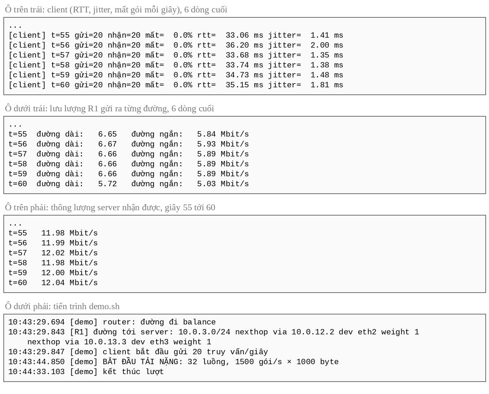
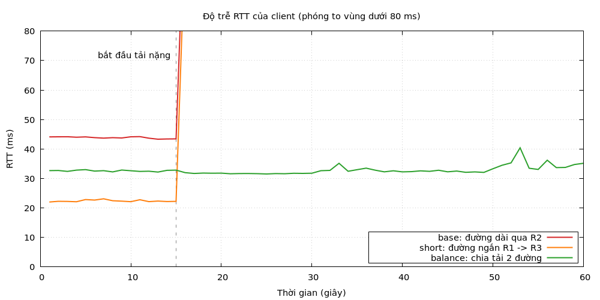
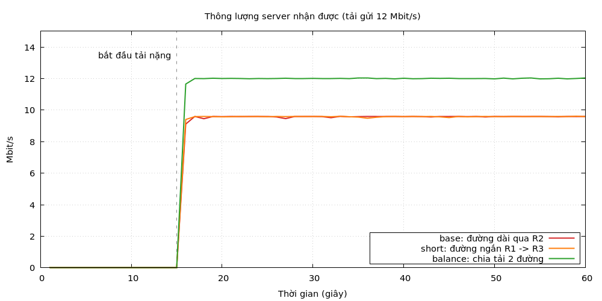
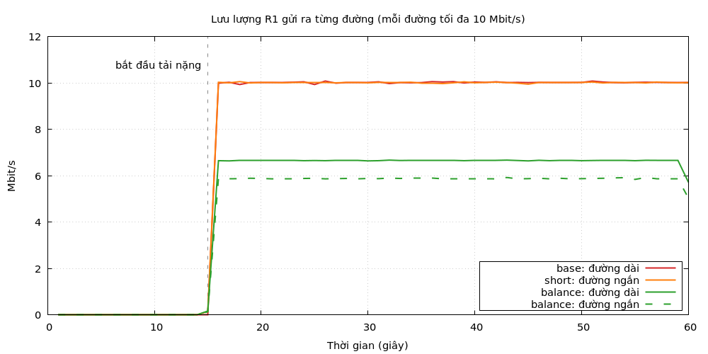

# THIẾT KẾ VÀ HIỆN THỰC

## Thiết kế mô hình mạng

### Thiết kế topology mạng

Mô hình gồm sáu node, mỗi node là một máy Linux độc lập. Client và loadgen nằm chung mạng LAN1 sau R1. Giữa R1 và R3 có hai đường: đường dài đi qua R2 và đường ngắn nối thẳng. Server nằm sau R3. Mọi node có thêm một card mạng nối vào mạng quản lý MGMT để script điều khiển từ xa.


Trên mỗi node, card mạng `eth0` luôn thuộc mạng quản lý 172.30.0.0/24, các card mạng từ `eth1` trở đi là mạng dữ liệu. Mạng quản lý chỉ dùng để SSH (Secure Shell) vào node, không có lưu lượng thử nghiệm đi qua, nên không ảnh hưởng tới số đo.

### Thiết kế địa chỉ IP

Bảng: Địa chỉ IP của các node
| Node | Card mạng | Địa chỉ IP | Mạng | Ghi chú |
|---|---|---|---|---|
| Loadgen | eth1 | 10.0.1.10/24 | LAN1 | Gateway 10.0.1.1 |
| Client | eth1 | 10.0.1.20/24 | LAN1 | Gateway 10.0.1.1 |
| R1 | eth1 | 10.0.1.1/24 | LAN1 | Phía người dùng |
| R1 | eth2 | 10.0.12.1/24 | R1 – R2 | Đường dài |
| R1 | eth3 | 10.0.13.1/24 | R1 – R3 | Đường ngắn |
| R2 | eth1 | 10.0.12.2/24 | R1 – R2 | Đường dài |
| R2 | eth2 | 10.0.23.2/24 | R2 – R3 | Đường dài |
| R3 | eth1 | 10.0.23.3/24 | R2 – R3 | Đường dài |
| R3 | eth2 | 10.0.3.1/24 | R3 – Server | Phía server |
| R3 | eth3 | 10.0.13.3/24 | R1 – R3 | Đường ngắn |
| Server | eth1 | 10.0.3.10/24 | R3 – Server | Gateway 10.0.3.1 |

### Thiết kế định tuyến

Client, loadgen và server dùng router gần nhất làm gateway mặc định. Ba router dùng định tuyến tĩnh. Bảng định tuyến của R2 không đổi; bảng định tuyến của R1 và R3 thay đổi theo kịch bản:

Bảng: Đường tới mạng đích của R1 và R3 theo từng kịch bản
| Router | Mạng đích | base | short | balance |
|---|---|---|---|---|
| R1 | 10.0.3.0/24 (server) | qua 10.0.12.2 | qua 10.0.13.3 | qua 10.0.12.2 và 10.0.13.3 |
| R3 | 10.0.1.0/24 (người dùng) | qua 10.0.23.2 | qua 10.0.13.1 | qua 10.0.23.2 và 10.0.13.1 |
| R2 | 10.0.1.0/24 và 10.0.3.0/24 | qua R1 và qua R3 | như base | như base |

Ở kịch bản balance, hai router kế tiếp có trọng số bằng nhau và R1, R3 đặt `net.ipv4.fib_multipath_hash_policy=1` để chọn đường theo cả địa chỉ lẫn cổng của từng luồng.

## Thiết lập môi trường

### Cài đặt EVE-NG

EVE-NG Community Edition bản 6.2.0-4 được cài vào một máy ảo KVM (Kernel-based Virtual Machine) trên laptop chạy Ubuntu, cấp 6GB RAM, 4 CPU ảo và ổ đĩa 60GB. CPU của máy ảo đặt ở chế độ `host-passthrough` để các node bên trong dùng được ảo hóa phần cứng. Trên Windows, có thể làm tương tự bằng VMware Workstation, với điều kiện tắt Hyper-V và bật tùy chọn ảo hóa VT-x cho máy ảo. Sau khi cài, mọi script của đề tài chạy bên trong máy ảo EVE-NG; máy thật chỉ cần trình duyệt và SSH.

### Tạo image và lab tự động

Script `lab/eve-make-image.sh` dùng công cụ `alpine-make-vm-image` [[REF:11]] tạo một ổ đĩa mẫu Alpine Linux {{alpine_version}} có sẵn SSH và bộ công cụ `iproute2` (lệnh `ip`, `tc`). Cả sáu node dùng chung ổ đĩa mẫu này. Để mỗi node tự nhận một địa chỉ quản lý khác nhau, một script khởi động trong image đọc địa chỉ MAC của `eth0`: EVE-NG đặt MAC theo định dạng `00:50:<tenant>:<id/512>:<id%512>:<cổng>`, từ đó tính ra số thứ tự node và đặt địa chỉ 172.30.0.(10 + số thứ tự).

Lab `net-perf` gồm sáu node, sáu mạng và toàn bộ dây nối được tạo bằng script `lab/eve-create-lab.sh` thông qua REST API của EVE-NG [[REF:12]]: đăng nhập, tạo lab, tạo mạng, tạo node, gán card mạng của từng node vào mạng, rồi khởi động node. Lab có thể được tạo lại giống hệt chỉ bằng một lệnh.


### Cấu hình đường truyền và chọn đường

Mỗi router có một tệp cấu hình `lab/<router>.sh`, nhận tham số là kịch bản chọn đường. Các đoạn đường truyền giữa hai router đều dùng chung một hàm cấu hình:

```
link() {
    tc qdisc del dev "$1" root 2>/dev/null || true
    tc qdisc add dev "$1" root handle 1: netem delay "$LINK_DELAY"
    tc qdisc add dev "$1" parent 1:1 handle 10: tbf rate "$LINK_RATE" burst 32kbit latency 400ms
}
```

Bộ `netem` thêm độ trễ truyền {{link_delay}} mili giây cho mọi gói đi ra. Bộ `tbf` bên dưới giới hạn tốc độ {{link_rate}} Mbit/s; tham số `latency` quy định hàng đợi chứa được lượng dữ liệu truyền trong {{queue_delay_ms}} mili giây, tức khoảng {{queue_kb}}KB. Vì `tc` chỉ tác động lên chiều đi ra, mỗi đoạn đường truyền được cấu hình ở cả hai router hai đầu.

Phần chọn đường của R1 chỉ là một dòng `ip route` khác nhau theo kịch bản:

```
if [ "$ROUTE" = "short" ]; then
    ip route replace 10.0.3.0/24 via 10.0.13.3
elif [ "$ROUTE" = "balance" ]; then
    ip route replace 10.0.3.0/24 nexthop via 10.0.12.2 weight 1 nexthop via 10.0.13.3 weight 1
else
    ip route replace 10.0.3.0/24 via 10.0.12.2
fi
```

R3 có đoạn tương tự cho chiều về mạng 10.0.1.0/24. Đổi kịch bản chỉ cần chạy lại tệp cấu hình với tham số mới, ví dụ `sh r1.sh balance`.

## Hiện thực các chương trình đo

### Giao thức và các chương trình

Đề tài gồm ba chương trình C, biên dịch tĩnh bằng `gcc -static` để chép thẳng sang node Alpine mà không cần cài thêm thư viện:

Bảng: Các chương trình đo của đề tài
| Chương trình | Chạy ở | Chức năng |
|---|---|---|
| `server` | Server | Nghe UDP cổng 9000. Truy vấn `Q <số thứ tự> <thời điểm>` được trả lời bằng `A <số thứ tự> <thời điểm>`. Gói tải `D ...` chỉ được đếm. Mỗi giây ghi số gói và thông lượng nhận được |
| `client` | Client | Gửi {{client_rate}} truy vấn mỗi giây, khớp trả lời theo số thứ tự để tính RTT, jitter và tỷ lệ mất gói |
| `loadgen` | Loadgen | Gửi gói UDP {{load_size}} byte với tốc độ {{load_rate}} gói/giây, chia đều cho {{load_flows}} luồng |

Gói tải bắt đầu bằng ký tự `D` để server phân biệt với truy vấn và không trả lời, nhờ đó chiều về chỉ có lưu lượng nhỏ của client.

Loadgen tạo mỗi luồng bằng một socket riêng, gắn cố định cổng nguồn 20000, 20001, ... để router nhận ra đó là các luồng khác nhau. Vòng lặp gửi tính số gói lẽ ra đã phải gửi tới thời điểm hiện tại, gửi bù phần còn thiếu lần lượt qua từng socket, rồi tạm dừng 1 mili giây. Cách gửi bù này giữ đúng tốc độ trung bình dù hệ điều hành không đảm bảo thời gian tạm dừng chính xác.

### Tính RTT, jitter và tỷ lệ mất gói

Module `stats` của client giữ một bảng vòng 4.096 ô, vị trí của mỗi truy vấn là số thứ tự chia lấy dư cho kích thước bảng. Khi gửi, client ghi thời điểm gửi vào ô đó. Khi nhận trả lời, client tìm lại ô theo số thứ tự và lấy hiệu thời gian làm RTT. Client dùng đồng hồ của chính nó (`CLOCK_MONOTONIC`), nên kết quả không phụ thuộc đồng hồ của server.

Jitter được tính bằng trung bình độ lệch tuyệt đối giữa RTT của hai trả lời liên tiếp. Truy vấn quá một giây chưa có trả lời được tính là mất. Trả lời tới muộn hơn mức đó, trả lời trùng lặp hoặc trả lời cho số thứ tự lạ đều bị bỏ qua.

### Kiểm thử đơn vị

Hai module dùng chung được kiểm thử bằng bộ test tự viết, chạy bằng lệnh `make test`:

Bảng: Các bộ kiểm thử đơn vị
| Bộ test | Số ca | Nội dung kiểm tra chính |
|---|---|---|
| `test_proto` | 6 | Tạo và đọc truy vấn, chấp nhận phần đệm phía sau, gói tải `D` không bị coi là truy vấn, từ chối gói sai định dạng, đồng hồ tăng dần |
| `test_stats` | 10 | Tính RTT, mất gói khi quá hạn, trả lời muộn tính là mất, trả lời trùng chỉ đếm một lần, bỏ qua số thứ tự lạ, tính jitter đúng và giữ RTT trước đó qua các giây |

Cả 16 ca kiểm thử đều đạt.

## Tiến hành thực nghiệm

### Các script điều khiển thực nghiệm

Mọi bước thực nghiệm được tự động hóa bằng script:

Bảng: Các script điều khiển thực nghiệm
| Script | Chức năng |
|---|---|
| `scripts/lab-up.sh` | Bật sáu node, chép chương trình và cấu hình, kiểm tra kết nối và thử cả ba kịch bản chọn đường; in `SẴN SÀNG` nếu mọi bước đạt |
| `scripts/demo.sh <kịch bản>` | Chạy một lượt {{duration}} giây và lưu số liệu |
| `scripts/tmux-demo.sh <kịch bản>` | Chạy một lượt kèm màn hình theo dõi bốn ô |
| `scripts/run-all.sh` | Chạy liên tiếp ba kịch bản rồi vẽ biểu đồ |
| `scripts/plot.sh` | Tính trung bình, in bảng so sánh, vẽ biểu đồ |
| `scripts/reset.sh` | Dừng mọi chương trình đo trên các node |

Mỗi lượt diễn ra như trình bày ở mục 3.4.3: cấu hình router theo kịch bản, khởi động server, bộ đo lưu lượng trên R1 và client; tới giây thứ {{load_at}} khởi động loadgen; hết lượt thì dừng mọi chương trình và lưu kết quả.

### Màn hình theo dõi

Trong lúc chạy, màn hình terminal được chia làm bốn ô. Hình dưới vẽ lại nội dung bốn ô ở cuối lượt balance, lấy từ chính các tệp số liệu của lượt đó.



### Kết quả ba lượt thử nghiệm

Ba lượt được chạy liên tiếp trên lab EVE-NG với cùng thông số: client {{client_rate}} truy vấn/giây, loadgen {{load_mbit}} Mbit/s gồm {{load_flows}} luồng, bắt đầu từ giây {{load_at}}.

Bảng: Kết quả đo ba lượt thử nghiệm trên EVE-NG
| Kịch bản | RTT chưa có tải (ms) | RTT có tải (ms) | Jitter có tải (ms) | Client mất gói (%) | Server nhận được (Mbit/s) | Đường dài (Mbit/s) | Đường ngắn (Mbit/s) |
|---|---|---|---|---|---|---|---|
| base | {{idle_base}} | {{rtt_base}} | {{jitter_base}} | {{loss_base}} | {{server_base}} | {{long_base}} | {{short_base}} |
| short | {{idle_short}} | {{rtt_short}} | {{jitter_short}} | {{loss_short}} | {{server_short}} | {{long_short}} | {{short_short}} |
| balance | {{idle_balance}} | {{rtt_balance}} | {{jitter_balance}} | {{loss_balance}} | {{server_balance}} | {{long_balance}} | {{short_balance}} |

## Phân tích kết quả

### Phân tích độ trễ RTT


Hình trên cho thấy rõ hai giai đoạn của mỗi lượt. Trước giây {{load_at}}, RTT của cả ba lượt đều thấp. Khi loadgen bắt đầu gửi, RTT của lượt base và short tăng vọt lên vài trăm mili giây trong khoảng hai giây rồi giữ nguyên tới hết lượt, còn RTT của lượt balance gần như không đổi.



Phóng to vùng độ trễ thấp cho thấy khác biệt lúc mạng chưa có tải:

- **base:** RTT khoảng {{idle_base}} mili giây, sát với giá trị lý thuyết {{prop_long_ms}} mili giây của bốn lần đi qua đường truyền.
- **short:** RTT khoảng {{idle_short}} mili giây, sát với giá trị lý thuyết {{prop_short_ms}} mili giây, giảm {{idle_drop_short}}% so với base. Đây là tác dụng của đường ngắn và ít thiết bị trung gian.
- **balance:** RTT khoảng {{idle_balance}} mili giây, gần giá trị {{prop_mixed_ms}} mili giây ứng với trường hợp chiều đi và chiều về của client được chia vào hai đường khác nhau.

Phần chênh lệch nhỏ so với lý thuyết là thời gian xử lý trên các máy ảo và độ trễ phát của gói.

Khi có tải, phần RTT tăng thêm của lượt base là {{queue_added_base}} mili giây và của lượt short là {{queue_added_short}} mili giây, đều xấp xỉ thời gian xả hết một hàng đợi đầy ({{queue_delay_ms}} mili giây). Như vậy, khi mạng tắc nghẽn, độ trễ xếp hàng chiếm phần lớn RTT, và lợi ích của đường ngắn (khoảng {{prop_short_ms}} mili giây) trở nên không đáng kể: RTT có tải của lượt short chỉ thấp hơn lượt base {{rtt_drop_short}}%.

Ở lượt balance, phần RTT tăng thêm khi có tải chỉ là {{queue_added_balance}} mili giây. RTT có tải là {{rtt_balance}} mili giây, giảm {{rtt_drop_balance}}% so với lượt base, tức thấp hơn khoảng {{rtt_ratio_balance}} lần.

### Phân tích Jitter


Jitter của cả ba lượt đều nhỏ, từ {{jitter_balance}} tới {{jitter_base}} mili giây. Ở lượt base và short, hàng đợi luôn đầy nên mọi truy vấn của client chờ gần như cùng một khoảng thời gian: độ trễ cao nhưng đều. Lượt balance có jitter thấp nhất vì không có hàng đợi dồn ứ. Riêng thời điểm tải vừa bắt đầu, jitter của lượt base và short tăng vọt vì hàng đợi đang đầy dần, RTT của các truy vấn liên tiếp chênh nhau nhiều.

### Phân tích mất gói và thông lượng



Client không mất gói ở cả ba lượt. Nguyên nhân là hàng đợi giới hạn theo số byte: khi hàng đầy, gói tải {{load_size}} byte tới sau bị loại bỏ, còn truy vấn rất nhỏ của client vẫn vào được hàng, chỉ phải chờ.

Lưu lượng tải thì khác. Ở lượt base và short, server chỉ nhận được {{server_base}} Mbit/s trên {{load_mbit}} Mbit/s gửi đi, tức khoảng {{dropped_pct_base}}% lưu lượng tải bị loại bỏ vì vượt băng thông của một đường. Ở lượt balance, server nhận đủ {{server_balance}} Mbit/s. Như vậy phân phối tải không những giảm độ trễ mà còn tăng lượng dữ liệu truyền được, vì tận dụng được đường truyền bị bỏ trống ở hai lượt kia.

### Phân tích phân bố tải trên các đường



Ở lượt base, đường dài chạy kín {{long_base}} Mbit/s trong khi đường ngắn bỏ trống; ở lượt short thì ngược lại, đường ngắn chạy kín {{short_short}} Mbit/s. Ở lượt balance, R1 chia {{load_flows}} luồng ra hai đường, đường dài nhận {{long_balance}} Mbit/s và đường ngắn nhận {{short_balance}} Mbit/s. Hai con số không bằng nhau tuyệt đối vì hàm băm chia theo luồng chứ không theo từng gói, nhưng cả hai đều thấp hơn băng thông {{link_rate}} Mbit/s, nên không đường nào bị tắc nghẽn.

### So sánh tổng hợp

Bảng: So sánh các kịch bản với kịch bản base
| Tiêu chí | base | short | balance |
|---|---|---|---|
| RTT chưa có tải (ms) | {{idle_base}} | {{idle_short}} (giảm {{idle_drop_short}}%) | {{idle_balance}} |
| RTT có tải (ms) | {{rtt_base}} | {{rtt_short}} (giảm {{rtt_drop_short}}%) | {{rtt_balance}} (giảm {{rtt_drop_balance}}%) |
| Phần RTT tăng thêm do xếp hàng (ms) | {{queue_added_base}} | {{queue_added_short}} | {{queue_added_balance}} |
| Lưu lượng tải bị loại bỏ (%) | {{dropped_pct_base}} | {{dropped_pct_short}} | {{dropped_pct_balance}} |

Kết quả cho thấy hai cách chọn đường tác động vào hai thành phần khác nhau của độ trễ. Đường ngắn giảm phần độ trễ truyền, hiệu quả khi mạng thông thoáng. Phân phối tải loại bỏ phần độ trễ xếp hàng, thành phần chiếm phần lớn khi mạng có tải. Với mạng có lưu lượng lớn, phân phối tải mang lại mức giảm độ trễ lớn hơn nhiều.

### Một số vấn đề gặp phải

Quá trình hiện thực có một số vấn đề cần ghi nhận, vì chúng cho thấy khác biệt giữa lý thuyết và môi trường chạy thật.

- **Chênh lệch giữa hai đường quá nhỏ để đo.** Lúc đầu, các đường truyền chỉ được giới hạn băng thông mà không có độ trễ truyền. Vì mọi máy ảo nằm trên cùng một laptop, đi thêm một router chỉ chậm hơn chưa tới một mili giây, nhỏ hơn mức dao động tự nhiên của máy ảo. Việc thêm độ trễ truyền bằng `netem` mô phỏng đúng thực tế là các router ở xa nhau, và làm cho khác biệt giữa đường dài và đường ngắn đo được rõ ràng.
- **Tải chia lệch khi có ít luồng.** Với 8 luồng, hàm băm của R1 có lần chia 6 luồng vào một đường và 2 luồng vào đường kia, làm đường nhận nhiều luồng gần chạm băng thông. Hàm băm của Linux còn dùng một giá trị ngẫu nhiên sinh lúc khởi động, nên cách chia thay đổi sau mỗi lần khởi động lại. Tăng số luồng lên {{load_flows}} làm cách chia ổn định quanh mức một nửa, giống mạng thật có rất nhiều luồng.
- **Số liệu thông lượng bị kéo xuống ở cuối lượt.** Server khởi động trước và dừng sau loadgen, nên tệp số liệu của server có thêm vài giây không có tải ở cuối. Ban đầu các giây này bị tính vào trung bình, làm thông lượng của lượt balance thấp hơn thực tế. Cách tính được sửa để chỉ lấy các giây nằm trong thời gian của lượt thử nghiệm.
- **Lượt thử nghiệm bị treo trên Alpine.** Lệnh `pkill -x` của BusyBox trên Alpine so tên với cả đường dẫn chương trình nên không tìm thấy tiến trình cần dừng. Lỗi được sửa bằng cách dùng `killall`.
