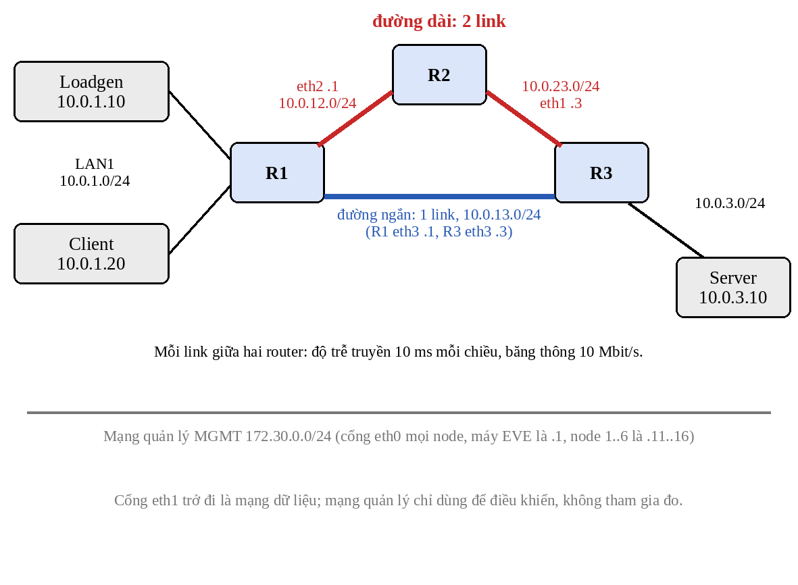
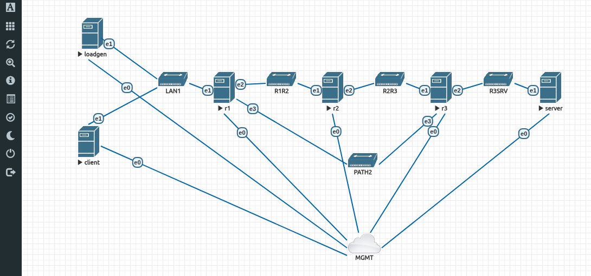
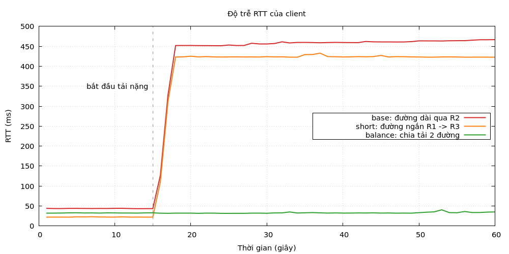
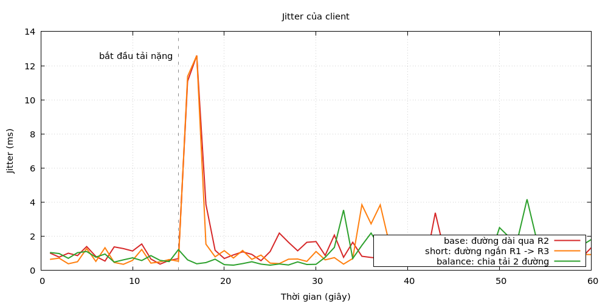

# THIẾT KẾ VÀ HIỆN THỰC

## Thiết kế mô hình mạng

### Thiết kế topology mạng

Mô hình gồm sáu node, mỗi node là một máy Linux riêng. Client và loadgen nằm chung mạng LAN1 sau R1, server nằm sau R3. Giữa R1 và R3 có hai đường: đường dài đi qua R2 và đường ngắn nối thẳng. Ngoài ra node nào cũng có thêm một card mạng nối vào mạng quản lý MGMT để script điều khiển từ xa.



Trên mọi node, card mạng `eth0` luôn thuộc mạng quản lý 172.30.0.0/24, còn từ `eth1` trở đi là mạng dữ liệu. Mạng quản lý chỉ dùng để SSH (Secure Shell) vào node, không có lưu lượng thử nghiệm nào đi qua nên không ảnh hưởng tới số đo.

### Thiết kế địa chỉ IP

Bảng: Địa chỉ IP của các node
| Node | Card mạng | Địa chỉ IP | Mạng | Ghi chú |
|---|---|---|---|---|
| Loadgen | eth1 | 10.0.1.10/24 | LAN1 | Gateway 10.0.1.1 |
| Client | eth1 | 10.0.1.20/24 | LAN1 | Gateway 10.0.1.1 |
| R1 | eth1 | 10.0.1.1/24 | LAN1 | Phía người dùng |
| R1 | eth2 | 10.0.12.1/24 | R1 – R2 | Đường dài |
| R1 | eth3 | 10.0.13.1/24 | R1 – R3 | Đường ngắn |
| R2 | eth1 | 10.0.12.2/24 | R1 – R2 | Đường dài |
| R2 | eth2 | 10.0.23.2/24 | R2 – R3 | Đường dài |
| R3 | eth1 | 10.0.23.3/24 | R2 – R3 | Đường dài |
| R3 | eth2 | 10.0.3.1/24 | R3 – Server | Phía server |
| R3 | eth3 | 10.0.13.3/24 | R1 – R3 | Đường ngắn |
| Server | eth1 | 10.0.3.10/24 | R3 – Server | Gateway 10.0.3.1 |

### Thiết kế định tuyến

Client, loadgen và server lấy router gần nhất làm gateway mặc định. Ba router dùng định tuyến tĩnh. Bảng định tuyến của R2 cố định, còn của R1 và R3 thay đổi theo kịch bản như bảng dưới.

Bảng: Đường tới mạng đích của R1 và R3 theo từng kịch bản
| Router | Mạng đích | base | short | balance |
|---|---|---|---|---|
| R1 | 10.0.3.0/24 (server) | qua 10.0.12.2 | qua 10.0.13.3 | qua 10.0.12.2 và 10.0.13.3 |
| R3 | 10.0.1.0/24 (người dùng) | qua 10.0.23.2 | qua 10.0.13.1 | qua 10.0.23.2 và 10.0.13.1 |
| R2 | 10.0.1.0/24 và 10.0.3.0/24 | qua R1 và qua R3 | như base | như base |

Ở kịch bản balance, hai router kế tiếp có trọng số bằng nhau. R1 và R3 đặt `net.ipv4.fib_multipath_hash_policy=1` để chọn đường dựa trên cả địa chỉ lẫn cổng của từng luồng.

## Thiết lập môi trường

### Cài đặt EVE-NG

EVE-NG Community Edition bản 6.2.0-4 được cài vào một máy ảo KVM (Kernel-based Virtual Machine) trên laptop chạy Ubuntu, cấp 6GB RAM, 4 CPU ảo và ổ đĩa 60GB. CPU của máy ảo đặt ở chế độ `host-passthrough` để các node bên trong dùng được ảo hóa phần cứng. Trên Windows, có thể làm tương tự bằng VMware Workstation, với điều kiện tắt Hyper-V và bật tùy chọn ảo hóa VT-x cho máy ảo. Sau khi cài xong, mọi script của đề tài đều chạy bên trong máy ảo EVE-NG, máy thật chỉ cần trình duyệt và SSH.

### Tạo image và lab tự động

Script `lab/eve-make-image.sh` dùng công cụ `alpine-make-vm-image` [[REF:11]] tạo một ổ đĩa mẫu Alpine Linux {{alpine_version}} có sẵn SSH và bộ công cụ `iproute2` (lệnh `ip`, `tc`). Cả sáu node dùng chung ổ đĩa mẫu này. Để mỗi node tự nhận một địa chỉ quản lý riêng, image có một script chạy lúc khởi động, đọc địa chỉ MAC của `eth0`. EVE-NG đặt MAC theo định dạng `00:50:<tenant>:<id/512>:<id%512>:<cổng>`, nên từ MAC tính ngược ra được số thứ tự node, rồi đặt địa chỉ 172.30.0.(10 + số thứ tự).

Lab `net-perf` với sáu node, sáu mạng và toàn bộ dây nối được tạo bằng script `lab/eve-create-lab.sh` qua REST API của EVE-NG [[REF:12]]. Script lần lượt đăng nhập, tạo lab, tạo mạng, tạo node, gán card mạng của từng node vào mạng rồi khởi động các node. Nhờ vậy lab có thể tạo lại y hệt chỉ bằng một lệnh.



### Cấu hình đường truyền và chọn đường

Mỗi router có một tệp cấu hình `lab/<router>.sh`, nhận tham số là kịch bản chọn đường. Mọi đoạn đường truyền giữa hai router đều được cấu hình bằng cùng một hàm:

```
link() {
    tc qdisc del dev "$1" root 2>/dev/null || true
    tc qdisc add dev "$1" root handle 1: netem delay "$LINK_DELAY"
    tc qdisc add dev "$1" parent 1:1 handle 10: tbf rate "$LINK_RATE" burst 32kbit latency 400ms
}
```

Bộ `netem` thêm độ trễ truyền {{link_delay}} mili giây cho mọi gói đi ra. Bộ `tbf` bên dưới giới hạn tốc độ {{link_rate}} Mbit/s; tham số `latency` quy định hàng đợi chứa được lượng dữ liệu truyền trong {{queue_delay_ms}} mili giây, tức khoảng {{queue_kb}}KB. Do `tc` chỉ tác động lên chiều đi ra, mỗi đoạn đường truyền phải được cấu hình ở cả hai router hai đầu.

Phần chọn đường của R1 chỉ khác nhau ở một dòng `ip route` tùy kịch bản:

```
if [ "$ROUTE" = "short" ]; then
    ip route replace 10.0.3.0/24 via 10.0.13.3
elif [ "$ROUTE" = "balance" ]; then
    ip route replace 10.0.3.0/24 nexthop via 10.0.12.2 weight 1 nexthop via 10.0.13.3 weight 1
else
    ip route replace 10.0.3.0/24 via 10.0.12.2
fi
```

R3 có đoạn tương tự cho chiều về mạng 10.0.1.0/24. Muốn đổi kịch bản chỉ cần chạy lại tệp cấu hình với tham số mới, ví dụ `sh r1.sh balance`.

## Hiện thực các chương trình đo

### Giao thức và các chương trình

Đề tài có ba chương trình C, được biên dịch tĩnh bằng `gcc -static` nên chép thẳng sang node Alpine là chạy được, không cần cài thêm thư viện.

Bảng: Các chương trình đo của đề tài
| Chương trình | Chạy ở | Chức năng |
|---|---|---|
| `server` | Server | Nghe UDP cổng 9000. Truy vấn `Q <số thứ tự> <thời điểm>` được trả lời bằng `A <số thứ tự> <thời điểm>`. Gói tải `D ...` chỉ được đếm. Mỗi giây ghi số gói và thông lượng nhận được |
| `client` | Client | Gửi {{client_rate}} truy vấn mỗi giây, khớp trả lời theo số thứ tự để tính RTT, jitter và tỷ lệ mất gói |
| `loadgen` | Loadgen | Gửi gói UDP {{load_size}} byte với tốc độ {{load_rate}} gói/giây, chia đều cho {{load_flows}} luồng |

Gói tải bắt đầu bằng ký tự `D` để server phân biệt với truy vấn và không trả lời, vì vậy chiều về chỉ có lưu lượng nhỏ của client.

Loadgen tạo mỗi luồng bằng một socket riêng, gắn cố định cổng nguồn 20000, 20001, ... để router coi đó là các luồng khác nhau. Trong vòng lặp gửi, chương trình tính xem tới lúc này lẽ ra đã phải gửi bao nhiêu gói, gửi bù phần còn thiếu lần lượt qua từng socket, rồi nghỉ 1 mili giây. Nhờ gửi bù, tốc độ trung bình vẫn đúng dù hệ điều hành không cho nghỉ chính xác từng mili giây.

### Tính RTT, jitter và tỷ lệ mất gói

Module `stats` của client dùng một bảng vòng 4.096 ô, mỗi truy vấn nằm ở ô có vị trí bằng số thứ tự chia lấy dư cho kích thước bảng. Lúc gửi, client ghi thời điểm gửi vào ô đó. Lúc nhận trả lời, client tìm lại ô theo số thứ tự và lấy hiệu thời gian làm RTT. Client chỉ dùng đồng hồ của chính nó (`CLOCK_MONOTONIC`), nên kết quả không phụ thuộc vào đồng hồ của server.

Jitter là trung bình độ lệch tuyệt đối giữa RTT của hai trả lời liên tiếp. Truy vấn nào quá một giây chưa có trả lời thì tính là mất. Những trả lời tới muộn hơn mức đó, trả lời trùng hoặc trả lời cho số thứ tự lạ đều bị bỏ qua.

### Kiểm thử đơn vị

Hai module dùng chung có bộ test riêng, chạy bằng lệnh `make test`.

Bảng: Các bộ kiểm thử đơn vị
| Bộ test | Số ca | Nội dung kiểm tra chính |
|---|---|---|
| `test_proto` | 6 | Tạo và đọc truy vấn, chấp nhận phần đệm phía sau, gói tải `D` không bị coi là truy vấn, từ chối gói sai định dạng, đồng hồ tăng dần |
| `test_stats` | 10 | Tính RTT, mất gói khi quá hạn, trả lời muộn tính là mất, trả lời trùng chỉ đếm một lần, bỏ qua số thứ tự lạ, tính jitter đúng và giữ RTT trước đó qua các giây |

Cả 16 ca kiểm thử đều chạy đạt.

## Tiến hành thực nghiệm

### Các script điều khiển thực nghiệm

Các bước thực nghiệm đều được tự động hóa bằng script như trong bảng dưới.

Bảng: Các script điều khiển thực nghiệm
| Script | Chức năng |
|---|---|
| `scripts/lab-up.sh` | Bật sáu node, chép chương trình và cấu hình, kiểm tra kết nối và thử cả ba kịch bản chọn đường; in `SẴN SÀNG` nếu mọi bước đạt |
| `scripts/demo.sh <kịch bản>` | Chạy một lượt {{duration}} giây và lưu số liệu |
| `scripts/tmux-demo.sh <kịch bản>` | Chạy một lượt kèm màn hình theo dõi bốn ô |
| `scripts/run-all.sh` | Chạy liên tiếp ba kịch bản rồi vẽ biểu đồ |
| `scripts/plot.sh` | Tính trung bình, in bảng so sánh, vẽ biểu đồ |
| `scripts/reset.sh` | Dừng mọi chương trình đo trên các node |

Mỗi lượt chạy theo trình tự ở mục 3.4.3. Đầu tiên router được cấu hình theo kịch bản, sau đó server, bộ đo lưu lượng trên R1 và client được khởi động. Tới giây thứ {{load_at}} thì loadgen bắt đầu gửi. Hết lượt, mọi chương trình được dừng lại và kết quả được lưu.

### Màn hình theo dõi

Trong lúc chạy, màn hình terminal được chia thành bốn ô. Hình dưới vẽ lại nội dung bốn ô ở cuối lượt balance, lấy từ chính các tệp số liệu của lượt này.


### Kết quả ba lượt thử nghiệm

Ba lượt được chạy liền nhau trên lab EVE-NG với cùng thông số: client {{client_rate}} truy vấn/giây, loadgen {{load_mbit}} Mbit/s gồm {{load_flows}} luồng, bắt đầu từ giây {{load_at}}.

Bảng: Kết quả đo ba lượt thử nghiệm trên EVE-NG
| Kịch bản | RTT chưa có tải (ms) | RTT có tải (ms) | Jitter có tải (ms) | Client mất gói (%) | Server nhận được (Mbit/s) | Đường dài (Mbit/s) | Đường ngắn (Mbit/s) |
|---|---|---|---|---|---|---|---|
| base | {{idle_base}} | {{rtt_base}} | {{jitter_base}} | {{loss_base}} | {{server_base}} | {{long_base}} | {{short_base}} |
| short | {{idle_short}} | {{rtt_short}} | {{jitter_short}} | {{loss_short}} | {{server_short}} | {{long_short}} | {{short_short}} |
| balance | {{idle_balance}} | {{rtt_balance}} | {{jitter_balance}} | {{loss_balance}} | {{server_balance}} | {{long_balance}} | {{short_balance}} |

## Phân tích kết quả

### Phân tích độ trễ RTT



Có thể thấy rõ hai giai đoạn trong mỗi lượt. Trước giây {{load_at}}, RTT của cả ba lượt đều thấp. Khi loadgen bắt đầu gửi, RTT của base và short vọt lên vài trăm mili giây chỉ trong khoảng hai giây rồi giữ nguyên tới hết lượt, trong khi RTT của balance gần như không đổi.


Khi phóng to vùng độ trễ thấp, có thể thấy sự khác nhau lúc mạng chưa có tải:

- base: RTT khoảng {{idle_base}} mili giây, sát với mức {{prop_long_ms}} mili giây tính theo lý thuyết cho bốn lần đi qua đường truyền.
- short: RTT khoảng {{idle_short}} mili giây, sát với mức lý thuyết {{prop_short_ms}} mili giây, thấp hơn base {{idle_drop_short}}%. Mức giảm này có được vì đường ngắn chỉ có một đoạn truyền và không đi qua R2.
- balance: RTT khoảng {{idle_balance}} mili giây, gần với mức {{prop_mixed_ms}} mili giây khi chiều đi và chiều về của client rơi vào hai đường khác nhau.

Phần chênh nhỏ so với lý thuyết đến từ thời gian xử lý trên các máy ảo và độ trễ phát của gói.

Khi có tải, RTT của base tăng thêm {{queue_added_base}} mili giây, của short tăng thêm {{queue_added_short}} mili giây, đều xấp xỉ thời gian xả hết một hàng đợi đầy ({{queue_delay_ms}} mili giây). Lúc mạng tắc nghẽn, phần lớn RTT là thời gian xếp hàng, nên khoảng {{prop_short_ms}} mili giây mà đường ngắn tiết kiệm được gần như không còn ý nghĩa. RTT có tải của short chỉ thấp hơn base {{rtt_drop_short}}%.

Ở lượt balance, RTT khi có tải chỉ tăng thêm {{queue_added_balance}} mili giây. RTT có tải là {{rtt_balance}} mili giây, giảm {{rtt_drop_balance}}% so với base, nghĩa là thấp hơn khoảng {{rtt_ratio_balance}} lần.

### Phân tích Jitter



Jitter trung bình của cả ba lượt đều nhỏ, từ {{jitter_balance}} tới {{jitter_base}} mili giây. Ở base và short, jitter chỉ vọt lên trong một hai giây đầu khi tải bắt đầu, vì lúc đó hàng đợi đang đầy dần nên RTT của các truy vấn liền nhau chênh lệch nhiều. Chính mấy giây chuyển tiếp này làm jitter trung bình của base và short cao hơn balance một chút. Sau khi hàng đợi đã đầy hẳn, truy vấn nào của client cũng chờ gần như bằng nhau, nên độ trễ tuy cao nhưng rất đều. Tóm lại, cả ba cách chọn đường đều cho jitter thấp; khác biệt thực sự giữa các lượt nằm ở độ lớn của RTT.

### Phân tích mất gói và thông lượng


Client không mất gói ở cả ba lượt. Lý do là hàng đợi được giới hạn theo số byte: khi hàng gần đầy, gói tải {{load_size}} byte tới sau bị bỏ, còn truy vấn rất nhỏ của client vẫn vào được hàng, chỉ phải chờ lâu.

Với lưu lượng tải thì khác. Ở base và short, server chỉ nhận được {{server_base}} Mbit/s trong số {{load_mbit}} Mbit/s gửi đi, khoảng {{dropped_pct_base}}% lưu lượng tải bị bỏ vì vượt băng thông của một đường. Ở balance, server nhận đủ {{server_balance}} Mbit/s. Nhờ dùng thêm đường truyền vốn để không ở hai lượt kia, phân phối tải vừa giảm độ trễ vừa truyền được nhiều dữ liệu hơn.

### Phân tích phân bố tải trên các đường


Ở lượt base, đường dài chạy kín {{long_base}} Mbit/s còn đường ngắn để không. Lượt short thì ngược lại, đường ngắn chạy kín {{short_short}} Mbit/s. Ở lượt balance, R1 chia {{load_flows}} luồng ra hai đường, đường dài nhận {{long_balance}} Mbit/s và đường ngắn nhận {{short_balance}} Mbit/s. Hai con số không bằng nhau hẳn vì hàm băm chia theo luồng chứ không theo từng gói, nhưng cả hai đều dưới băng thông {{link_rate}} Mbit/s nên không đường nào bị tắc.

### So sánh tổng hợp

Bảng: So sánh các kịch bản với kịch bản base
| Tiêu chí | base | short | balance |
|---|---|---|---|
| RTT chưa có tải (ms) | {{idle_base}} | {{idle_short}} (giảm {{idle_drop_short}}%) | {{idle_balance}} |
| RTT có tải (ms) | {{rtt_base}} | {{rtt_short}} (giảm {{rtt_drop_short}}%) | {{rtt_balance}} (giảm {{rtt_drop_balance}}%) |
| Phần RTT tăng thêm do xếp hàng (ms) | {{queue_added_base}} | {{queue_added_short}} | {{queue_added_balance}} |
| Lưu lượng tải bị loại bỏ (%) | {{dropped_pct_base}} | {{dropped_pct_short}} | {{dropped_pct_balance}} |

Hai cách chọn đường làm giảm hai phần khác nhau của độ trễ. Đường ngắn giảm thời gian truyền nên có tác dụng lúc mạng rảnh. Phân phối tải bỏ được thời gian xếp hàng, phần chiếm gần hết độ trễ lúc mạng đông. Vì vậy với mạng có lưu lượng lớn, phân phối tải giảm độ trễ nhiều hơn hẳn.

### Một số vấn đề gặp phải

Trong quá trình làm, em gặp một số vấn đề chỉ lộ ra khi chạy trên môi trường thật.

- **Chênh lệch giữa hai đường quá nhỏ để đo.** Ban đầu các đường truyền chỉ bị giới hạn băng thông, chưa có độ trễ truyền. Vì mọi máy ảo đều chạy trên cùng một laptop, RTT lúc chưa có tải chỉ vài mili giây và dao động giữa các lượt còn lớn hơn phần chênh lệch do đi thêm một router. Sau khi thêm độ trễ truyền bằng `netem` để mô phỏng việc các router ở xa nhau, khác biệt giữa đường dài và đường ngắn mới đo được rõ ràng.
- **Tải chia lệch khi có ít luồng.** Với 8 luồng, có lần hàm băm của R1 chia 6 luồng vào một đường và 2 luồng vào đường kia, làm đường bên nhiều luồng gần chạm băng thông. Hàm băm của Linux còn dùng một giá trị ngẫu nhiên sinh ra lúc khởi động, nên sau mỗi lần khởi động lại cách chia lại khác. Khi tăng lên {{load_flows}} luồng, số luồng trên mỗi đường gần bằng nhau và không đường nào vượt băng thông, giống mạng thật vốn có rất nhiều luồng.
- **Số liệu thông lượng bị kéo xuống ở cuối lượt.** Server khởi động trước và dừng sau loadgen, nên tệp số liệu của server có thêm vài giây cuối không có tải. Lúc đầu các giây này bị tính cả vào trung bình, làm thông lượng của lượt balance thấp hơn thực tế. Sau đó cách tính được sửa để chỉ lấy các giây nằm trong thời gian của lượt.
- **Lượt thử nghiệm bị treo trên Alpine.** Lệnh `pkill -x` của BusyBox trên Alpine so tên với cả đường dẫn chương trình nên không tìm ra tiến trình cần dừng. Đổi sang dùng `killall` thì hết lỗi.
