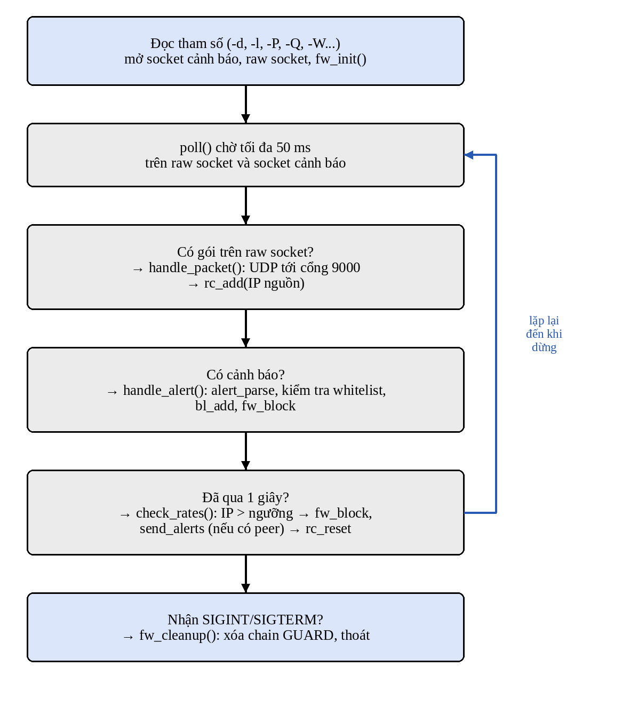
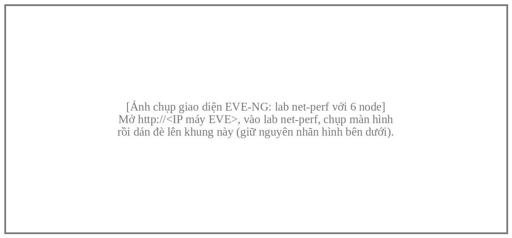
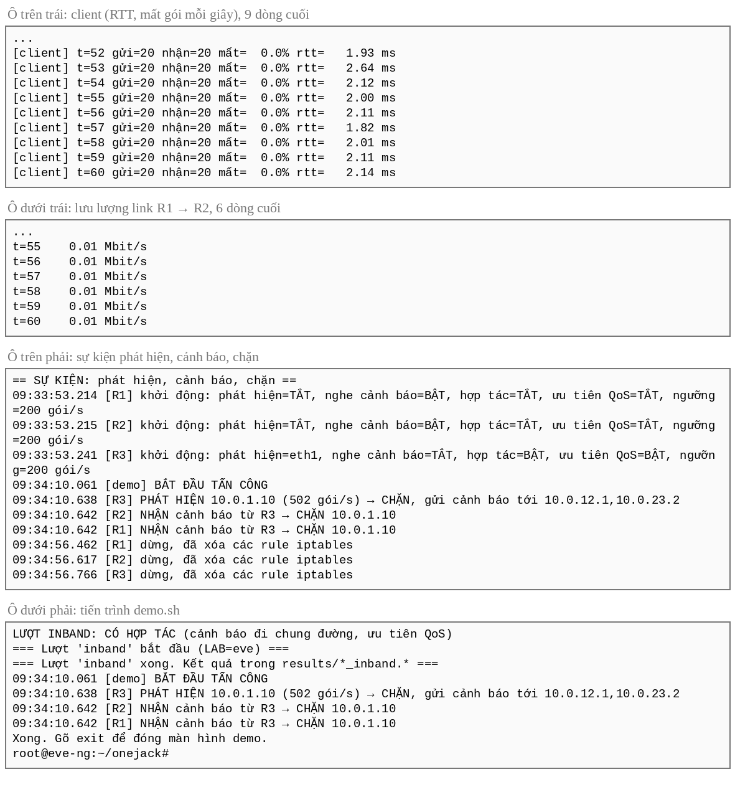
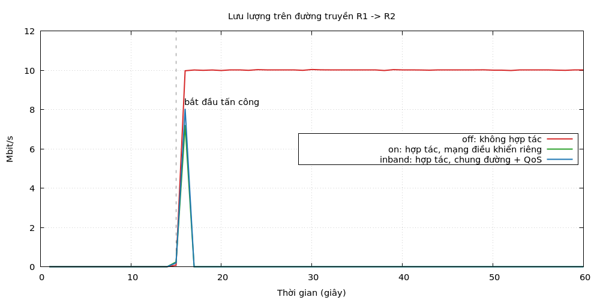

# THIẾT KẾ VÀ HIỆN THỰC

## Kiến trúc tổng thể

### Mô hình mạng

Mô hình gồm sáu node, mỗi node là một máy Linux độc lập. Attacker và client nằm chung mạng LAN1 sau R1. Ba router R1, R2, R3 nối thành một đường thẳng. Server nằm sau R3. Ngoài đường dữ liệu, ba router còn chung một mạng điều khiển CTRL dùng cho lượt **on**, và mọi node có thêm một cổng nối vào mạng quản lý MGMT để script điều khiển từ xa.


Bảng: Địa chỉ và vai trò của các node
| Node | Địa chỉ dữ liệu | Địa chỉ điều khiển | Vai trò |
|---|---|---|---|
| Attacker | 10.0.1.10 | | Gửi UDP flood |
| Client | 10.0.1.20 | | Người dùng thật, đo RTT |
| R1 | 10.0.1.1, 10.0.12.1 | 10.0.99.1 | Router cửa vào, nghe cảnh báo |
| R2 | 10.0.12.2, 10.0.23.2 | 10.0.99.2 | Router giữa, nghe cảnh báo |
| R3 | 10.0.23.3, 10.0.3.1 | 10.0.99.3 | Router gần server, phát hiện và gửi cảnh báo |
| Server | 10.0.3.10 | | Trả lời truy vấn ở cổng 9000 |

Trên mỗi node, cổng `eth0` luôn là mạng quản lý 172.30.0.0/24, các cổng từ `eth1` trở đi là mạng dữ liệu. Nhờ quy ước này, cùng một tệp cấu hình `lab/<node>.sh` dùng được cho cả lab EVE-NG lẫn bản thu nhỏ bằng network namespace.

### Tổ chức mã nguồn

Mã nguồn chia làm ba phần. Thư mục `src/` chứa bốn chương trình C (`server`, `client`, `attacker`, `guard`) và sáu module dùng chung (`proto`, `stats`, `ratecount`, `blocklist`, `alert`, `firewall`). Thư mục `lab/` chứa cấu hình mạng cho từng node và các script dựng lab. Thư mục `scripts/` chứa các script điều khiển demo: chạy lệnh trên một node, chuẩn bị lab, chạy một lượt, dọn dẹp, vẽ biểu đồ.

Toàn bộ chương trình C được biên dịch tĩnh bằng `gcc -static`. Tệp chạy được tạo trên một máy rồi chép thẳng sang các node Alpine mà không cần cài thêm thư viện hay trình biên dịch nào. Mọi script điều khiển đều đi qua một script trung gian là `node-run.sh`: với lab EVE-NG, script này SSH vào node; với bản thu nhỏ, nó chạy lệnh trong namespace tương ứng. Phần còn lại của hệ thống không cần biết đang chạy ở môi trường nào.

## Thiết kế giao thức

### Giao thức truy vấn

Truy vấn là một gói UDP dạng văn bản `Q <số thứ tự> <thời điểm>`, trả lời có dạng `A <số thứ tự> <thời điểm>`. Server không cần hiểu gì thêm: nhận `Q` thì đổi thành `A` và gửi lại đúng địa chỉ đã gửi tới.

Client tính RTT bằng đồng hồ của chính nó chứ không dựa vào đồng hồ server, vì đồng hồ của hai máy khác nhau có thể lệch nhau. Module `stats` giữ một bảng vòng 4.096 ô, vị trí của mỗi truy vấn là số thứ tự chia lấy dư cho kích thước bảng. Khi gửi, client ghi lại thời điểm gửi vào ô đó. Khi nhận trả lời, client tìm lại ô theo số thứ tự, lấy hiệu thời gian làm RTT. Truy vấn nào quá một giây chưa có trả lời thì bị tính là mất. Trả lời tới muộn hơn mức đó, trả lời trùng lặp, hoặc trả lời cho số thứ tự lạ đều bị bỏ qua.

Gói của attacker cũng bắt đầu bằng `Q`, phía sau được độn thêm ký tự cho đủ {{attack_size}} byte. Bộ phân tích gói chấp nhận phần đệm phía sau, nên nếu chỉ xét nội dung thì gói tấn công không khác gì truy vấn thật. Đây là chủ ý thiết kế: hệ thống buộc phải phân biệt bằng hành vi, đúng như tình huống thực tế.

### Giao thức cảnh báo

Cảnh báo là một gói UDP gửi tới cổng 9999 với nội dung `BLOCK <địa chỉ IP> <tên node>`, ví dụ `BLOCK 10.0.1.10 R3`. Vì đây là dữ liệu đến từ mạng, hàm `alert_parse` kiểm tra rất chặt: gói phải bắt đầu đúng bằng `BLOCK `, địa chỉ phải hợp lệ theo `inet_pton`, tên node chỉ gồm chữ, số, dấu gạch dưới và gạch ngang, dài tối đa 15 ký tự, và không được có gì khác phía sau. Gói không đạt bất kỳ điều kiện nào đều bị bỏ qua và ghi log.

Bảng: Các cổng và định dạng gói trong hệ thống
| Loại gói | Cổng UDP | Định dạng | Chiều đi |
|---|---|---|---|
| Truy vấn | 9000 | `Q <seq> <ts>` | Client, attacker → server |
| Trả lời | (cổng của bên hỏi) | `A <seq> <ts>` | Server → client |
| Cảnh báo | 9999 | `BLOCK <ip> <node>` | R3 → R1, R2 |

## Hiện thực các chương trình

### Server, client và attacker

**Server** mở một socket UDP ở cổng 9000, tăng bộ đệm nhận lên 4 MB để chịu được lúc bị dồn gói, rồi chạy một vòng lặp: chờ bằng `poll()`, mỗi lần có dữ liệu thì đọc liên tiếp tối đa 1.000 gói, trả lời từng gói hợp lệ. Mỗi giây server in số gói nhận được, tách theo địa chỉ nguồn.

**Client** gửi truy vấn đều đặn theo tốc độ cấu hình, giữa các lần gửi thì chờ trả lời tối đa 1 mili giây bằng `poll()`. Mỗi giây client tổng kết một dòng gồm số gói gửi, số gói nhận, tỉ lệ mất và RTT trung bình, in ra màn hình và ghi vào tệp CSV.

**Attacker** tính xem tới thời điểm hiện tại lẽ ra phải gửi bao nhiêu gói, gửi bù cho đủ, rồi nghỉ 1 mili giây. Cách gửi bù này giữ cho tốc độ trung bình đúng {{attack_rate}} gói/giây dù hệ điều hành không đảm bảo thời gian nghỉ chính xác.

### Chương trình guard

Guard là phần trung tâm của đề tài. Cùng một chương trình, chạy với các tham số khác nhau, sẽ đóng các vai khác nhau trên từng router.

Bảng: Các tham số dòng lệnh của guard
| Tham số | Ý nghĩa |
|---|---|
| `-n <tên>` | Tên node, dùng trong log và trong gói cảnh báo |
| `-d -i <cổng>` | Bật phát hiện, đếm gói đi vào cổng chỉ định |
| `-t <ngưỡng>` | Ngưỡng gói/giây, mặc định {{threshold}} |
| `-l -b <ip>` | Bật nghe cảnh báo trên địa chỉ chỉ định, cổng 9999 |
| `-P <ip>` | Thêm một peer nhận cảnh báo; có peer nghĩa là chế độ hợp tác |
| `-Q` | Đánh dấu gói cảnh báo là ưu tiên (TOS `0xB8`) |
| `-W <ip>` | Thêm địa chỉ vào whitelist, không bao giờ chặn |

Ở lượt **off**, R3 chạy với `-d -i eth1` và không có peer. Ở lượt **on**, R3 có thêm hai peer là 10.0.99.1 và 10.0.99.2, còn R1, R2 chạy với `-l` nghe trên địa chỉ mạng điều khiển. Ở lượt **inband**, R3 gửi tới địa chỉ dữ liệu 10.0.12.1 và 10.0.23.2 kèm `-Q`, còn R1, R2 nghe trên chính các địa chỉ dữ liệu đó.

Toàn bộ guard chạy trong một luồng duy nhất với vòng lặp `poll()`, chờ tối đa 50 mili giây trên raw socket và socket cảnh báo, như mô tả trong hình dưới.



Việc đếm gói nằm trong hàm `handle_packet`. Raw socket kiểu `SOCK_DGRAM` trả về gói IP đã bỏ tiêu đề Ethernet, nên hàm chỉ cần đọc trực tiếp các byte của tiêu đề IP và UDP. Đoạn dưới là phần chính của hàm, đã lược bớt các bước kiểm tra độ dài gói:

```
if ((pkt[0] >> 4) != 4) {                 // chỉ xét IPv4
    return;
}
int ihl = (pkt[0] & 0x0F) * 4;             // độ dài tiêu đề IP
if (pkt[9] != IPPROTO_UDP) {               // chỉ xét UDP
    return;
}
uint16_t dport = (uint16_t)((pkt[ihl + 2] << 8) | pkt[ihl + 3]);
if (dport != QUERY_PORT) {                 // chỉ đếm truy vấn tới cổng 9000
    return;
}
uint32_t src;
memcpy(&src, pkt + 12, sizeof(src));       // địa chỉ nguồn
rc_add(&rc, src);
```

Trước khi gọi hàm này, vòng lặp bỏ qua những gói có kiểu `PACKET_OUTGOING`. Raw socket gắn vào một cổng nhận bản sao của gói theo cả hai chiều, vào và ra. Bộ lọc này chỉ giữ lại gói đi vào cổng, để lưu lượng do chính router gửi ra trên cổng đó không bao giờ bị tính vào số đếm.

Cứ mỗi giây, hàm `check_rates` lấy danh sách địa chỉ vượt ngưỡng. Với mỗi địa chỉ, guard kiểm tra whitelist, kiểm tra xem đã chặn chưa, gọi iptables để chặn, rồi gửi cảnh báo nếu có peer. Cuối cùng bảng đếm được xóa để bắt đầu giây mới. Khi nhận tín hiệu `SIGINT` hoặc `SIGTERM`, vòng lặp kết thúc và guard gỡ toàn bộ chain `GUARD` trước khi thoát.

### Các module dùng chung

- **ratecount** đếm số gói theo địa chỉ nguồn trong một bảng tối đa 256 địa chỉ. Bảng đầy thì địa chỉ mới bị bỏ qua thay vì làm chương trình lỗi.
- **blocklist** nhớ các địa chỉ đã chặn và whitelist. Hàm `bl_allowed_to_block` từ chối mọi địa chỉ trong whitelist và mọi địa chỉ thuộc mạng điều khiển 10.0.99.0/24, để các router không bao giờ chặn nhầm lẫn nhau.
- **alert** tạo và phân tích gói cảnh báo như đã mô tả ở mục 4.2.2.
- **firewall** gọi iptables. Lúc khởi động, module tạo hoặc làm rỗng chain `GUARD` và gắn vào `FORWARD`. Khi chặn, nó thêm luật `-A GUARD -s <ip> -j DROP`. Khi dọn dẹp, nó gỡ chain khỏi `FORWARD` rồi xóa. Mọi lệnh đều chạy bằng `fork` và `execvp` với mảng tham số riêng, không đi qua shell, nên không thể bị chèn thêm lệnh. Module có chế độ chạy thử chỉ ghi lại câu lệnh, dùng cho kiểm thử đơn vị mà không cần quyền root.

## Cấu hình mạng và QoS

### Định tuyến và nút cổ chai

Mỗi router bật chuyển tiếp gói (`ip_forward`) và có các tuyến tĩnh tới những mạng không nối trực tiếp, ví dụ R1 đi tới 10.0.3.0/24 qua 10.0.12.2. Client và attacker dùng R1 làm gateway, server dùng R3. Lưu lượng trên đoạn R1 → R2 được đo bằng script `linkmon.sh` chạy trên R1: mỗi giây script đọc bộ đếm `tx_bytes` của cổng `eth2` trong `/sys/class/net`, lấy hiệu so với giây trước.

### Hàng đợi hai làn

Mọi cổng nối giữa hai router đều được giới hạn {{bottleneck}} Mbit/s theo cả hai chiều và chia hàng đợi làm hai làn. Cấu hình nằm trong hàm `bottleneck` dùng chung cho R1, R2, R3:

```
tc qdisc add dev "$1" root handle 1: tbf rate "$TC_RATE" burst 32kbit latency 400ms
tc qdisc add dev "$1" parent 1:1 handle 10: prio bands 2 priomap 1 1 1 1 1 1 1 1 1 1 1 1 1 1 1 1
tc qdisc add dev "$1" parent 10:1 handle 101: bfifo limit 500000
tc qdisc add dev "$1" parent 10:2 handle 102: bfifo limit 500000
tc filter add dev "$1" parent 10: protocol ip prio 1 u32 match ip dsfield 0xb8 0xfc flowid 10:1
```

Lớp ngoài `tbf` giới hạn tốc độ. Bên trong là `prio` với hai làn. Tham số `priomap` toàn số 1 đưa mọi gói vào làn thứ hai theo mặc định. Chỉ những gói được bộ lọc `u32` nhận ra có trường DSCP bằng EF (so khớp byte TOS `0xB8` với mặt nạ `0xFC`) mới vào làn thứ nhất. Mỗi làn chứa tối đa {{queue_kb}} KB. Ở {{bottleneck}} Mbit/s, một làn đầy cần khoảng {{queue_delay_ms}} ms để xả hết, và đây chính là mức RTT mà client gặp phải khi đường bị nghẽn.

Phía gửi, guard đánh dấu gói cảnh báo bằng một lệnh duy nhất trên socket cảnh báo khi có tham số `-Q`: `setsockopt(alert_fd, IPPROTO_IP, IP_TOS, &tos, sizeof(tos))` với `tos` bằng `0xB8`. Client cũng có tham số `-Q` tương tự, chỉ dùng trong script kiểm chứng QoS.

## Dựng môi trường thử nghiệm

### Cài đặt EVE-NG

EVE-NG Community Edition bản 6.2.0-4 được cài vào một máy ảo KVM trên laptop chạy Ubuntu, cấp 6 GB RAM, 4 vCPU và ổ đĩa 60 GB, CPU ở chế độ `host-passthrough` để các node bên trong dùng được ảo hóa phần cứng. Trên Windows, có thể làm tương tự bằng VMware Workstation, với điều kiện tắt Hyper-V và bật tùy chọn ảo hóa VT-x cho máy ảo. Sau khi cài, mọi script của đề tài đều chạy **bên trong** máy ảo EVE-NG. Máy thật chỉ cần trình duyệt và SSH, nên quy trình không phụ thuộc hệ điều hành của máy thật.

### Tạo image và lab tự động

Thay vì cài Alpine thủ công cho từng node, script `lab/eve-make-image.sh` dùng công cụ `alpine-make-vm-image` [[REF:10]] để tạo một ổ đĩa mẫu có sẵn SSH, iproute2 và iptables, kèm khóa SSH của máy EVE. Vấn đề còn lại là mỗi node cần một địa chỉ quản lý khác nhau, trong khi cả sáu node chạy chung một ổ đĩa mẫu. Lời giải dựa vào cách EVE-NG đặt địa chỉ MAC cho card mạng: định dạng là `00:50:<tenant>:<id/512>:<id%512>:<cổng>`, trong đó `id` là số thứ tự node. Một script khởi động trong image đọc MAC của `eth0`, tính ra số thứ tự node rồi tự đặt địa chỉ 172.30.0.(10 + id).

Lab gồm sáu node, sáu mạng và toàn bộ dây nối được tạo bằng script `lab/eve-create-lab.sh` thông qua REST API của EVE-NG [[REF:11]]: đăng nhập, tạo lab, tạo mạng, tạo node, gán cổng của từng node vào mạng, rồi bật node. Nhờ vậy lab có thể được tạo lại giống hệt chỉ bằng một lệnh, thay vì kéo thả trên giao diện web.



### Kịch bản chạy demo

Mỗi lần chuẩn bị trình diễn, script `scripts/lab-up.sh` bật sáu node, chờ tới khi SSH vào được, chép chương trình và cấu hình mạng sang từng node, rồi chạy một loạt kiểm tra: client ping được server, R1 ping được R3 qua mạng điều khiển, client gửi truy vấn thật trong 3 giây và nhận đủ trả lời, RAM còn trống đủ dùng. Đạt hết thì script in `SẴN SÀNG`.

Một lượt demo do `scripts/demo.sh` điều khiển và kéo dài {{duration}} giây: dọn dẹp, bật server, bật guard theo vai trò của lượt, sau 2 giây bật bộ đo lưu lượng và client, tới giây thứ {{attack_at}} thì bật attacker, cuối lượt dọn dẹp lần nữa và lưu toàn bộ kết quả vào `results/`. Để khán giả theo dõi trực tiếp, `scripts/tmux-demo.sh` chia màn hình terminal làm bốn ô: RTT của client, lưu lượng link R1 → R2, các sự kiện phát hiện và chặn, và tiến trình của `demo.sh`. Hình dưới vẽ lại nguyên văn nội dung bốn ô ở cuối lượt inband.



## Kiểm thử và kết quả

### Kiểm thử đơn vị

Các module dùng chung được kiểm thử bằng bộ test tự viết, chạy bằng lệnh `make test`. Bốn chương trình chính không có kiểm thử đơn vị riêng, mà được kiểm tra bằng cách chạy demo thật.

Bảng: Các bộ kiểm thử đơn vị
| Bộ test | Số ca | Nội dung kiểm tra chính |
|---|---|---|
| `test_proto` | 5 | Tạo và phân tích truy vấn, chấp nhận phần đệm phía sau, từ chối gói sai định dạng, đồng hồ tăng dần |
| `test_stats` | 7 | Tính RTT, mất gói khi quá hạn, trả lời muộn tính là mất, trả lời trùng chỉ đếm một lần, bỏ qua số thứ tự lạ |
| `test_ratecount` | 4 | Chỉ báo địa chỉ vượt ngưỡng, đúng bằng ngưỡng không tính là vượt, bảng đầy không lỗi, xóa bộ đếm |
| `test_blocklist` | 4 | Không chặn trùng, không bao giờ chặn mạng điều khiển và whitelist, chặn được attacker |
| `test_alert` | 3 | Tạo và phân tích cảnh báo, từ chối cảnh báo sai định dạng, chấp nhận ký tự xuống dòng ở cuối |
| `test_firewall` | 2 | Câu lệnh iptables chặn và dọn dẹp đúng (chế độ chạy thử) |

Cả 25 ca kiểm thử đều đạt, trên máy phát triển và trên máy EVE-NG.

### Kết quả ba lượt demo

Ba lượt được chạy liên tiếp trên lab EVE-NG với cùng thông số: client {{client_rate}} gói/giây, attacker {{attack_rate}} gói/giây × {{attack_size}} byte bắt đầu từ giây {{attack_at}}, ngưỡng {{threshold}} gói/giây. Trước khi bị tấn công, RTT trung bình của client là {{rtt_base}} ms. Bảng dưới lấy trung bình các giây sau giây thứ {{attack_at}}, tức từ lúc bị tấn công tới hết lượt.

Bảng: Kết quả đo ba lượt demo trên EVE-NG
| Lượt | RTT trung bình | Mất gói | Lưu lượng R1 → R2 | R3 phát hiện sau | R1 chặn sau khi R3 phát hiện |
|---|---|---|---|---|---|
| off | {{rtt_off}} ms | 0% | {{link_off}} Mbit/s | {{detect_off}} giây | không chặn |
| on | {{rtt_on}} ms | 0% | {{link_on}} Mbit/s | {{detect_on}} giây | {{block_on_ms}} ms |
| inband | {{rtt_inband}} ms | 0% | {{link_inband}} Mbit/s | {{detect_inband}} giây | {{block_inband_ms}} ms |




Ở lượt **off**, R3 chặn attacker chưa tới một giây sau khi tấn công bắt đầu, server không còn nhận gói rác. Nhưng đường R1 → R2 vẫn chạy kín {{link_off}} Mbit/s cho tới hết lượt, và RTT của client nằm ở mức {{rtt_off}} ms, gấp hơn một trăm lần lúc bình thường. Server được bảo vệ, còn mạng thì không.

Ở hai lượt có hợp tác, R1 nhận cảnh báo và chặn chỉ vài mili giây sau R3. Cần lưu ý các mốc thời gian này được đóng dấu khi dòng log về tới máy chạy `demo.sh` qua kết nối SSH, nên có sai số cỡ vài mili giây. Con số cho biết bậc độ lớn, không phải độ trễ chính xác của gói cảnh báo. Ngay giây kế tiếp, lưu lượng trên link về gần như chỉ còn của client, RTT trở lại khoảng {{rtt_base}} ms. Con số trung bình {{rtt_on}} ms và {{rtt_inband}} ms cao hơn mức bình thường chỉ vì có một giây đầu tiên của cuộc tấn công, trước khi kịp phát hiện. Client không mất gói ở cả ba lượt. Lý do là hàng đợi giới hạn theo byte, như đã phân tích ở mục 2.2.2: gói truy vấn nhỏ vẫn chen được vào hàng đợi, chỉ phải chờ lâu.

Kết quả lượt **inband** gần như trùng với lượt **on**. Điều này đúng với dự đoán: cảnh báo đi theo chiều R3 → R2 → R1, ngược chiều với lưu lượng tấn công, nên chiều này không bị nghẽn. Để biết QoS có thực sự giữ cho cảnh báo đi được khi đường nghẽn hay không, cần một phép đo riêng.

### Kiểm chứng QoS

Script `scripts/qos-check.sh` cho attacker làm nghẽn đường R1 → R2 → R3 và **không** bật guard, nên không ai chặn. Trong lúc đó, client gửi hai loạt truy vấn trên cùng con đường, mỗi loạt 5 giây: loạt thường, và loạt đánh dấu ưu tiên giống hệt gói cảnh báo.

Bảng: Kết quả kiểm chứng làn ưu tiên khi đường đang nghẽn
| Môi trường | RTT truy vấn thường | RTT truy vấn ưu tiên |
|---|---|---|
| EVE-NG | {{qos_normal_eve}} ms | {{qos_prio_eve}} ms |
| Network namespace | {{qos_normal_netns}} ms | {{qos_prio_netns}} ms |

Bộ đếm của `tc` trên R1 sau lần đo cho thấy làn ưu tiên đã chuyển {{qos_prio_pkts}} gói và không vứt gói nào, trong khi làn thường vứt {{qos_normal_dropped}} gói. Nói cách khác, gói mang dấu EF đi qua một đường đang nghẽn nhanh gần như lúc đường trống. Đây là bằng chứng cho thấy cảnh báo ở lượt inband vẫn tới nơi kể cả khi chiều đi của nó bị nghẽn.

### Một số vấn đề gặp phải

Quá trình hiện thực có vài lỗi đáng ghi lại, vì chúng cho thấy những khác biệt giữa môi trường thử nghiệm và môi trường phát triển.

- **Lượt demo bị treo trên EVE-NG.** Script dọn dẹp dùng `pkill -x guard` để dừng chương trình. Lệnh này chạy đúng trên Ubuntu nhưng không khớp gì trên Alpine, vì `pkill` của BusyBox so tên với cả đường dẫn `/root/guard`. Guard không dừng, `demo.sh` chờ mãi. Lỗi được sửa bằng cách dùng `killall`.
- **Sáu node nhận trùng một địa chỉ quản lý.** Bản đầu tiên của script khởi động đọc sai vị trí byte trong địa chỉ MAC, nên node nào cũng tính ra cùng một số thứ tự. Sau khi đọc lại mã nguồn EVE-NG để biết đúng định dạng MAC, script được sửa và cả sáu node nhận đúng địa chỉ.
- **Log sự kiện sai thứ tự.** Đồng hồ của các node lệch nhau gần một giây, nên dòng "R2 nhận cảnh báo" có lúc hiện trước dòng "R3 phát hiện". Cách sửa là bỏ dấu thời gian do từng node tự in, và đóng dấu lại bằng đồng hồ của máy chạy `demo.sh` ngay khi dòng log tới nơi.
